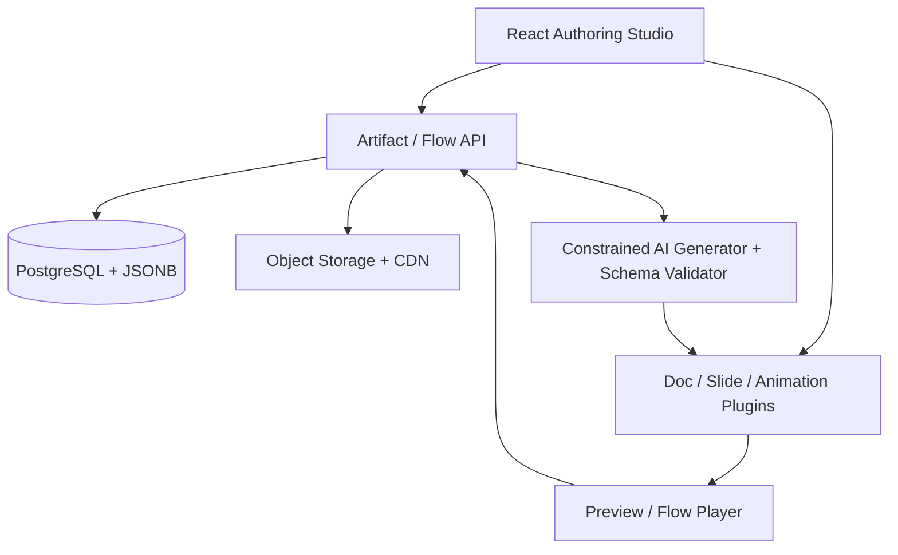

# Reusable Artifacts Studio — Product Requirements & Technical Specification

**Status:** Refined discovery draft (v0.2) — six product decisions confirmed  
**Date:** 29 October 2026  
**Owner:** Fernando Peres  
**Scope:** MVP and architectural direction; implementation blockers appear in §14. Supersedes the original v0.1 assumptions.

## 1. Product vision

Create an authoring and delivery **harness for Reusable Artifacts (RAs)**: small, self-contained units of learning or explanation that can be generated through AI-assisted/vibe coding, subsequently edited visually, versioned, localized, discovered, and reused in multiple ordered **Artifact Flows**.

The product adapts the reusable-learning-object idea—granular, discoverable, self-contained, adaptable learning content—to a more general artifact system. A flow composes existing artifacts without owning their content. The same slide, document, or animation can appear in different lessons, modules, or learning paths.

**Product principle:** *Generate once, edit freely, reuse deliberately, publish safely.* AI-assisted creation must yield an **editable source of truth**, not just a rendered screenshot, flattened HTML, or opaque React component.

### Confirmed MVP decisions (29 October 2026)

1. **Structured-first AI generation:** The AI generates content from a versioned, allowlisted React meta-component registry and typed JSON schemas. Arbitrary TSX/code generation is not required for MVP.
2. **Advanced slide editing:** The slide is a free-positioning visual canvas, with text, shapes, images, charts, groups, layers, resize/rotate, and style controls in the spirit of Canva/Keynote.
3. **Parameter-driven animations:** Authors edit content/data, visual parameters, transitions, timings, and exposed states. A general-purpose visual timeline is not required for MVP.
4. **Locale-specific version sequences:** An RA has independent publication counters for each locale: e.g. EN v1/v2 and PT v1/v2. Drafts do not consume published version numbers.
5. **Stable published flows:** Publishing an Artifact Flow freezes its ordered step references to specific published artifact-version IDs; later RA updates do not change that flow revision.
6. **Small-team workflow:** Authors and reviewers/publishers collaborate with distinct permissions. Enterprise multi-tenancy is not required initially.

**Product implication:** The choice of editor SDK is subordinate to the content contract. A generated meta-component is acceptable only if it has a persistent schema, a deterministic renderer, and an editor for all advertised properties.

### Key vocabulary

| Term | Meaning |
|---|---|
| **Reusable Artifact (RA)** | Stable logical identity and aggregate root; owns common metadata and versions. |
| **Artifact Version** | A specific language-specific content snapshot, with state, content payload, and version comment. |
| **Artifact Type** | `doc`, `slide`, or `animation` initially; extensible by plugins. |
| **Box / Unit / Section** | Three-level content organization hierarchy. RAs can be placed at any of these levels. |
| **Artifact Flow** | Ordered collection of RA references; played or browsed as a learning trail. |
| **Meta-component** | Registered, schema-driven component or editing contract from which an editor and renderer can be built. |
| **Asset** | Managed resource: image, document, font, video, data, or other uploaded/reference material. |

## 2. Target users and jobs

1. **Author/instructor:** Create a short explainer, edit its text/design, add learning objectives, and reuse it across lessons.
2. **Instructional designer:** Curate metadata, resources, checklists, prerequisites, and assemble flows for different audiences.
3. **Reviewer/publisher:** Review a proposed draft, request changes or approve, and publish an immutable version.
4. **Learner/presenter:** Consume a flow, navigate previous/next or the full outline, and view the correct language/version.
5. **AI-assisted creator:** Turn a prompt into schema-valid content using registered meta-components and a manifest of editable properties.

## 3. Goals, success criteria, and non-goals

### Goals

- Support three first-class RA types: editable Notion-like document, single-page presentation slide, and React animation.
- Create and modify an RA through AI-assisted coding **and** later change it in a UI without regenerating it.
- Store a stable RA identity with multiple versions, languages, status, active/inactive flags, and mandatory change comments at publication.
- Search by name, metadata, tags, and location in the Box / Unit / Section hierarchy.
- Assemble ordered flows from RAs; support previous, next, and jump-to navigation.
- Reuse an artifact without copying it; published flow revisions always pin specific versions.
- Support a small author/reviewer team, with explicit edit, review, and publication rights.
- Provide author preview, published reader/player, and provenance of components/assets.

### Initial success measures (proposed; validate in pilot)

- An author can generate, visually edit, save, and preview each initial RA type end-to-end, including free positioning, grouping, shapes, and editable chart data in slides.
- At least one RA can be reused in two flows with no duplicated artifact content.
- A published version remains unchanged after creating and editing its successor draft.
- The system reliably loads an explicitly pinned published version and language.
- Search and hierarchy navigation find the same artifact.
- A reviewer can request changes to a draft and publish an approved revision; an author without publish permission cannot bypass review.

### Non-goals for MVP

- Full LMS features: enrollment, grading, SCORM/xAPI certification, learner analytics.
- Real-time simultaneous co-editing, threaded discussions, and multi-stage enterprise approval workflows. A basic reviewer approval step **is** in scope.
- Complete Canva/Keynote feature parity or perfect editable PPTX round trips; core canvas editing capabilities **are** in scope.
- Arbitrary untrusted NPM packages or arbitrary React code running in the main application origin.
- A full timeline/video editor for animation.
- Multi-tenant enterprise administration.

## 4. Main user journeys

### A. Create an artifact

1. Navigate to a Box, Unit, or Section, or create one.
2. Select `doc`, `slide`, or `animation`; optionally start from template, prompt, or import.
3. Generate or author content with type-specific meta-components.
4. Visually edit text, layout, palette, typography, imagery, data, and exposed interaction/animation parameters.
5. Add title, tags, description, learning objective, estimated duration, design notes/checklist, resources, and language.
6. Save draft; preview; submit to reviewer. The reviewer approves and publishes with a mandatory version comment.

### B. Revise a published artifact

1. Open RA (default: latest appropriate language version; show version availability).
2. Select **Edit** on a published version. System creates a **new working draft derived from that version**; it never modifies the published snapshot.
3. Edit and save the draft any number of times.
4. Submit for review; on approval/publish, system allocates the next **locale-specific** version number transactionally and retains the previous published version.
5. See where the RA is used. Existing published FlowRevisions remain pinned and unchanged; a new FlowRevision is required to incorporate the updated RA.

### C. Build and consume a flow

1. Create a flow with title, description, purpose/audience, and optional language.
2. Search/browse RAs and insert ordered steps; reorder by drag-and-drop.
3. Choose a published RA version and locale for each step. In an editable flow draft, a convenient “use current default” picker may resolve at selection time.
4. Preview the entire flow; publishing atomically snapshots **concrete artifact-version IDs and their order**.
5. In player mode, navigate Previous / Next / Outline; resume and direct-link to a step.

## 5. Domain model and invariants

### 5.1 Hierarchy

`Box (project) → Unit → Section`. A parent may contain children and/or RAs. Each RA belongs to exactly one location, at Box, Unit, or Section level. Tags are independent of the tree. Moving an RA changes its location, not its ID or versions. Flows may combine RAs from any location.

### 5.2 RA aggregate

| Entity | Key fields |
|---|---|
| `Artifact` | `id`, `type`, `title`, `slug`, `description`, `locationId`, `tags[]`, `metadata`, `instructionalDesign`, `resources[]`, `createdBy`, timestamps; derived status. |
| `ArtifactVersion` | `id`, `artifactId`, `locale`, `versionNumber` (nullable for draft; sequential per locale on publish), `state`, `isActive`, `isDefault`, `parentVersionId`, `sourceVersionId`, `changeComment`, `contentSchemaVersion`, `content`, `componentManifest`, `createdBy`, timestamps. |
| `Asset` | `id`, `kind`, `storageKey/url`, `mimeType`, `checksum`, `license/attribution`, `metadata`, usage references. |
| `Flow` | `id`, `title`, `description`, `metadata`, `locale`, creator, timestamps. |
| `FlowRevision` | `id`, `flowId`, `revision`, `state`, `steps[]`, `changeComment`, timestamps. |
| `FlowStep` | `id`, `position`, `artifactId`, `locale`, **required `artifactVersionId` in published revisions**, optional presenter note/label. |
| `ReviewRequest` | `id`, `artifactDraftVersionId`, `submittedBy`, `reviewerId`, `reviewStatus` (`pending`/`approved`/`changes_requested`), comments, timestamps. This is separate from artifact lifecycle state. |

`instructionalDesign` should include at minimum `objective`, `audience`, `prerequisites`, `estimatedMinutes`, `designNotes`, `checklist[]`, and optional `speakerScript`. Clarify whether scripts and objectives need localization/versioning; see §14.

### 5.3 Version/state policy (confirmed baseline)

| Operation | Rule |
|---|---|
| Create RA | Create root + first localized draft in one transaction. |
| Save draft | Mutable draft content and metadata edits; autosave revisions may be stored separately. `versionNumber=null` until publication. |
| Edit published | **Fork into new draft** with `parentVersionId`. Original published snapshot stays immutable. |
| Submit draft for review | Set review request to `pending`; version lifecycle state remains `draft`. A reviewer can approve or request changes. |
| Publish approved draft | Validate schema/assets/review approval, require non-empty change comment, atomically allocate `MAX(versionNumber)+1` **within (artifactId, locale)**, snapshot content and dependencies, mark `published`. |
| Archive version | Mark `archived` and not available for default live resolution; preserve historical content and pinned references by policy. |
| Activate/deactivate | Independent of publication. Several published versions can be active at once; one is designated **default per locale** for new author selections and standalone RA links. |
| RA derived status | `draft-only`, `has-published`, or `archived-only` derived from child versions; no separately writable RA state. |
| Open RA | Prefer latest edited draft for author if selected; otherwise default published version in requested locale. Always show a version switcher. |

**Important design distinction:** `state` answers *where is this version in its editorial lifecycle?* (`draft`, `published`, `archived`); `reviewStatus` tracks approval without adding a fourth content state; `isActive` answers *may it be selected for new uses?*; `isDefault` answers *which one resolves from a standalone RA link or editor picker?* Multiple active versions allow one default published version per locale. Drafts never resolve to learner-facing flows.

Published content is immutable; republishing is a new version, not an overwrite. Archive/deactivate are metadata operations with an audit event. Default selection and version allocation must be atomic. A database uniqueness constraint on `(artifact_id, locale, version_number)` applies to published numbered versions. Consider exact retention/deletion rules before launch.

### 5.4 Languages

- Language/locale is a property of the version; e.g. `en`, `pt-PT`, `pt-BR`.
- **Version numbers restart per locale:** `en v1, en v2` and `pt-PT v1, pt-PT v2` may coexist; use `versionId` (not version label alone) as the reference key.
- A version may be translated from another (`sourceVersionId`); translations have independently editable content.
- Default live resolution requires an explicit locale, an artifact default for that locale, and a declared fallback policy if unavailable (e.g. show unavailable vs fall back to English).
- A flow can specify locale per flow and optionally override locale per step; users can switch language where a valid target exists.

### 5.5 Flow composition

**Binding requirement:** Published FlowRevisions pin an ordered list of specific `artifactVersionId` values and locale values. No floating/latest reference is allowed in a published revision. New RA versions never alter a published flow; updating one or more steps creates a new draft FlowRevision, then review/publish. An authoring convenience action may replace the draft's selected versions with the current defaults. A single RA can appear multiple times in the same or different flows.

## 6. Functional requirements

| ID | Priority | Requirement / acceptance behavior |
|---|---|---|
| FR-01 | P0 | Create/edit/archive Box, Unit, Section; place/move RA at any level. |
| FR-02 | P0 | Create RA of each type with title, language, metadata, tags, and resources. |
| FR-03 | P0 | Generate RA from prompt using **registered** meta-components, constrained JSON schemas, validation, and a correction/retry path when the output is unsupported. |
| FR-04 | P0 | Persist editable structured document blocks, slide elements, chart data, and animation properties, not flattened render output. |
| FR-05 | P0 | Doc editor: headings, paragraphs, lists, links, images, tables, embeds, custom learning blocks. |
| FR-06 | P0 | Slide editor: 16:9 default canvas; free move/resize/rotate text/images/shapes; selection, multiselection, grouping, layers/z-order, alignment/snapping, font/color/style controls, undo/redo. |
| FR-06a | P0 | Create line/bar/pie charts from a **persisted, editable data+style model**, rather than SVG/image-only charts. Changes to chart data regenerate the visual without losing editability. |
| FR-07 | P0 | Animation player and forms/inspectors for exposed parameters, colors, text, data, transitions, speed, and states; preview/restart/pause. No generalized timeline editor. |
| FR-08 | P0 | Draft autosave and schema-validated preview; clear unsaved/error state. |
| FR-09 | P0 | Immutable published snapshots; new draft from published; reviewer approval and mandatory publication comment; full version history. |
| FR-10 | P0 | Independent per-locale published version numbers, active/inactive flags, and one default published version per locale; version selection by immutable ID. |
| FR-11 | P0 | Browse tree; search full title/description/tags; filter type/language/status/location. |
| FR-12 | P0 | Create flow; add/remove/reorder RA steps; previous/next/outline player. |
| FR-13 | P0 | All published flow steps pin version IDs; new RA publication does not alter existing published FlowRevisions. |
| FR-14 | P0 | Version preview, compare metadata and content changes, view where-used flows. |
| FR-15 | P1 | Locale-aware flow player and translation/duplicate-version workflow. |
| FR-16 | P1 | Artifact templates, duplication, share links, and simple export (e.g. PDF/PNG/HTML as applicable). |
| FR-17 | P2 | Controlled custom React component import/build/preview with editable prop manifest; separate advanced code path. |
| FR-18 | P0 | Small-team roles: admin, author, reviewer/publisher, viewer; draft submission, approve/request changes, publication authorization, audit log. |
| FR-19 | P2 | Live co-editing, complex approval chains, activity analytics, advanced flow branching, LMS integrations. |

### 6.1 Permission and review matrix (proposed team baseline)

| Action | Author | Reviewer/publisher | Admin | Viewer |
|---|---|---|---|---|
| Create/edit own or assigned drafts | Yes | Yes | Yes | No |
| Submit draft for review | Yes | Yes | Yes | No |
| Approve/request changes | No | Yes | Yes | No |
| Publish/activate/archive | No | Yes | Yes | No |
| Create/edit draft flows | Yes | Yes | Yes | No |
| Publish FlowRevision | No | Yes | Yes | No |
| View published content | Yes | Yes | Yes | Yes |

Review approval is an explicit permission gate. The version's `state` remains `draft` while a review request is pending. Editing after approval invalidates the approval (draft revision hash changes) and requires a new approval. Whether reviewers may approve their own submissions is still open (§14).

## 7. Artifact schemas and meta-components

### 7.1 Uniform versioned content envelope

Persist typed JSON, with a `schemaVersion` and `rendererVersion`/component manifest to make migrations and old-version playback reproducible. Example:

```json
{
  "artifactId": "ra_001",
  "versionId": "rav_003",
  "locale": "en",
  "versionNumber": 2,
  "state": "published",
  "isActive": true,
  "isDefault": true,
  "changeComment": "Clarified the attention example and changed diagram colors",
  "content": {
    "schemaVersion": 1,
    "type": "slide",
    "engine": "slide-canvas-v1",
    "canvas": { "width": 1920, "height": 1080, "background": "#111827" },
    "elements": [
      { "id": "e1", "type": "text", "x": 120, "y": 95,
        "width": 930, "height": 140, "text": "What is attention?",
        "style": { "fontFamily": "Inter", "fontSize": 76, "color": "#ffffff" } }
    ]
  }
}
```

The example represents **EN v2**; PT versions follow an independent sequence. The exact schema remains subject to editor prototyping. Prefer an adapter layer when integrating an editor SDK and keep persisted component IDs stable.

### 7.2 Type adapters

Each type implements a stable contract:

```ts
type ArtifactPlugin = {
  type: 'doc' | 'slide' | 'animation' | (string & {});
  schemaVersion: number;
  validate(content: unknown): ValidationResult;
  Editor: React.ComponentType<ArtifactEditorProps>;
  Renderer: React.ComponentType<ArtifactRendererProps>;
  createEmpty(): unknown;
  migrate(fromVersion: number, content: unknown): unknown;
  extractAssets(content: unknown): string[];
  getSearchText(content: unknown): string;
};
```

Shared shell: `ArtifactWorkspace`, `ArtifactHeader`, `MetadataPanel`, `VersionSwitcher`, `ResourcesPanel`, `DesignChecklist`, `PreviewPane`, `PublishDialog`, `UsagePanel` and `FlowPlayer`. Type-specific editor components plug into this shell.

### 7.3 Meta-component registry and generation contract (MVP)

Each approved component definition includes:

- `componentType` and `componentVersion` (stable IDs).
- A **Zod/JSON Schema** for editable props, default values, allowed ranges/enums, and asset references.
- An editor adapter (property controls and, if needed, canvas behaviors), React renderer, and preview renderer.
- Optional source assets, labels, responsive constraints, theme tokens, and serialization/migration functions.

Illustrative registry entries: `doc.paragraph`, `doc.callout`, `slide.text`, `slide.shape`, `slide.image`, `slide.chart`, `animation.reveal`, `animation.networkGraph`.

**Generation pipeline:**

1. Author selects artifact type, optional template, and prompt.
2. Server sends an allowlist of component manifests and schema descriptions to the AI generation adapter.
3. Model returns structured content **without executable source code**.
4. Server validates schema, component IDs, asset references, supported positions/styles, and limits; repairs/retries invalid data or reports actionable errors.
5. Valid document opens in its visual editor; author can change any declared editable property.
6. Save draft; preview uses the same data/renderer as publication. Publication records registry/component versions for reproducibility.

Do not silently rasterize, replace with a screenshot, or accept unknown component types: the user must be told that a feature is unsupported.

### 7.4 Type-specific content requirements

**Document:** Structured blocks with native rich text plus reusable instructional blocks (definition, example, warning, question, comparison, embedded RA reference). Text remains editable after generation. A document can embed an artifact **reference**, with explicit pinning rules to avoid implicit content copies.

**Slide:** A **single editable slide RA** is the MVP working assumption (confirmation required). Page dimensions default to 16:9, with configurable size later. Each layer has stable element ID, type, transform (x/y/width/height/rotation), z-order, visibility/lock and style. Groups and multi-selection are first-class operations. Charts persist underlying datasets, series, axes, labels, palette, and layout; a derived SVG/canvas rendering is not the source of truth. Slide AI output maps to the same editor-native or adapter-native element schema.

**Animation:** Registered React animation templates expose a typed `props`/controls schema: data, labels, colors, sizes, timing, easings, interaction toggles, playback state, and scene parameters. The author can preview/pause/replay and change the exposed parameters. MVP does **not** promise arbitrary structural editing of the component's React source or a full keyframe timeline. Interaction/animation state must reset predictably during editing and playback.

### 7.5 Critical editability boundary

Two creation modes should be distinguished:

1. **Structured generation (MVP decision):** AI emits validated schema data from an approved component registry. The editor can modify every exposed field later; renderer and editor consume the same source of truth.
2. **Custom React/code artifact (post-MVP option):** AI writes source + dependency manifest + typed property schema. A build service validates/compiles it, and a restricted preview/player renders it. The visual editor can modify **declared props**, not arbitrary JSX structure. Full arbitrary visual editing of generated React source is not guaranteed. A code editor and regenerated-component workflow may be necessary for structural changes.

Promising the complete visual editability of arbitrary generated React is out of scope unless an AST round-trip/visual-code editor architecture is explicitly built and tested. The MVP should favor a governed component catalog and typed design model.

## 8. React ecosystem recommendation (subject to prototype and license review)

| Area | Recommended candidate | Why / qualification |
|---|---|---|
| Notion-like docs | **BlockNote** | React block editor with custom block schemas; fast Notion-like experience. Tiptap is a flexible alternative if full control over the document model matters more. |
| Slide design | **Polotno SDK** | Strong canvas/editor candidate with JSON schema, typography, shapes, grouping and layers. **Not yet approved**: commercial license, chart data editing, custom components, and export limitations require prototyping. Alternative: **react-konva** for an open, custom editor at substantially higher implementation effort. |
| React animations | **Motion for React** | Declarative transitions, gestures, keyframes. Build editable component props and templates on top. |
| Video/timeline compositions (later) | **Remotion + Player** | React compositions and embedded playback; not a built-in universal visual authoring editor. |
| Flow reorder | **dnd-kit** (evaluate) | Drag-and-drop reordering for step lists. |
| UI/data | React + TypeScript, Zod, a state store, accessible component kit | Component registry, validation, property forms, undo/redo, schema migrations. |

**Source review:** [ScienceDirect RLO overview](https://www.sciencedirect.com/topics/social-sciences/reusable-learning-object); [BlockNote](https://www.blocknotejs.org/docs); [BlockNote custom blocks](https://www.blocknotejs.org/docs/features/custom-schemas/custom-blocks); [Tiptap JSON](https://tiptap.dev/docs/guides/output-json-html); [Polotno overview](https://polotno.com/docs/overview); [Polotno JSON/export](https://polotno.com/docs/import-and-export); [Motion](https://motion.dev/docs/react); [Remotion Player](https://www.remotion.dev/docs/player).

**Material Polotno findings / prototype gate:**

- Its SDK is commercially licensed; request a quote and review terms before making it an architecture dependency ([pricing](https://polotno.com/sdk/pricing), [license](https://polotno.com/legal/license)).
- Its base design schema supports text, image, SVG, line, figure, GIF, video, table, and group, but **charts are commonly represented as SVG** with custom data attached. Our requirement for chart **data editing** needs a custom chart inspector/model and re-rendering, not just an SVG graphic ([element schema](https://polotno.com/docs/schema), [chart rendering](https://polotno.com/docs/charts-rendering)).
- Custom element support is experimental, with limitations in cloud rendering and standalone exports; interactive React components should generally remain `animation` RAs rather than be embedded as native slide objects until verified ([custom elements](https://polotno.com/docs/custom-elements)).
- Spike must demonstrate generating a full slide from structured JSON, reloading it, editing/free-moving every required element, changing chart data, saving, and replaying the same JSON. If it fails, switch to a controlled react-konva editor or revise the canvas/plugin boundary.

## 9. Reference architecture



**Suggested shape (not yet committed):** React/TypeScript frontend; FastAPI or TypeScript backend (choose based on existing stack); PostgreSQL for metadata, locale-specific versions, review records, flow revisions, and JSONB payloads; S3-compatible storage for assets and thumbnails; background workers for thumbnails/conversion; full-text search in PostgreSQL first. Use stable IDs and service boundaries regardless of initial monolith/modularity decision. An isolated code-build worker and bundle registry are **post-MVP only** if arbitrary React source imports become a requirement.

**Security:** For MVP, the AI returns typed JSON and only approved, application-shipped React components are executed. Validate inputs and restrict asset origins. If arbitrary React code is enabled in later phases, never evaluate it unsandboxed in the authoring shell: build in restricted workers with allowlisted dependencies and resource limits; render untrusted output in origin-isolated iframe with CSP and constrained permissions; restrict network/file/credential access; scan/validate code and pin dependencies/bundle hashes. Preserve asset licensing/attribution. Do not enable arbitrary code uploads until this path is designed and tested.

## 10. Initial API contract (illustrative)

```http
POST   /api/v1/artifacts
GET    /api/v1/artifacts?query=&tag=&type=&locationId=&locale=
GET    /api/v1/artifacts/{artifactId}
PATCH  /api/v1/artifacts/{artifactId}
POST   /api/v1/artifacts/{artifactId}/drafts?fromVersionId=
PATCH  /api/v1/artifact-versions/{versionId}
POST   /api/v1/artifact-versions/{versionId}/submit-review
POST   /api/v1/reviews/{reviewId}/approve
POST   /api/v1/reviews/{reviewId}/request-changes
POST   /api/v1/artifact-versions/{versionId}/publish
POST   /api/v1/artifact-versions/{versionId}/archive
PATCH  /api/v1/artifact-versions/{versionId}/activation
GET    /api/v1/artifacts/{artifactId}/versions
GET    /api/v1/artifacts/{artifactId}/usages
POST   /api/v1/flows
PATCH  /api/v1/flows/{flowId}/draft
POST   /api/v1/flows/{flowId}/publish
GET    /api/v1/flows/{flowId}/revisions/{revisionId}/play
POST   /api/v1/generations
POST   /api/v1/assets
```

Requests must carry authorization and optimistic concurrency tokens (`ETag`/`If-Match` or revision IDs). Publishing and default switches must execute transactionally. Publish response includes new immutable version ID, **locale and locale-specific number**, plus version-resolution information. `PATCH /artifact-versions/{versionId}` must reject modifications to published/archived content. `POST /flows/{flowId}/publish` resolves and freezes every ordered step to an existing published version ID.

## 11. Key UI surfaces

1. **Library explorer:** left tree (Boxes/Units/Sections), central searchable RA grid, tag/type/language/status filters, create button.
2. **Artifact workspace:** document/canvas/animation editor, configuration inspector, style tools, layer panel for slides, editable chart data panel, metadata, design checklist, resources, language/version selector, submit-review controls.
3. **Version history:** grouped by locale, each with independent numbering, status, activity, comment, parent, active/default labels, preview/diff, restore-as-draft.
4. **Flow builder:** library picker, sortable list of RA steps, explicit selected language/version per step, outline preview, frozen-version publishing.
5. **Flow player:** responsive RA content, title/step count, Previous/Next, interactive outline, language selector, optional presenter script.
6. **Review inbox:** submitted drafts, change summaries, preview, instructional-design checklist, approve/request changes/publish with audit history.

## 12. Nonfunctional requirements

- **Integrity:** Version snapshots are immutable; asset refs and component versions are reproducible; publishing is atomic and auditable.
- **Locale version integrity:** Unique published sequence per `artifactId + locale`; retries/races cannot allocate duplicate numbers.
- **Flow integrity:** Published revisions are immutable lists of existing published version IDs; subsequent publishing of referenced artifacts does not alter playback.
- **Team permissions:** Authors may draft and submit; only reviewers/publishers or admins can approve/publish, enforced on the API rather than UI alone.
- **Performance:** Draft autosave should feel near-immediate; lazy-load editor plugins and heavy canvases; cache thumbnails and published renders. Set numerical SLOs after initial measurements.
- **Accessibility:** Keyboard operation, screen-reader labels, color contrast, reduced-motion mode, alt text, and accessible flow navigation.
- **Portability:** Responsive reader; published content should have stable permalinks. Export/embedding policy remains open.
- **Searchability:** Metadata, title, tags, location, and optionally extracted text indexed; archived results filterable.
- **Security/privacy:** Authentication, per-Box authorization policy if needed, sanitized rich text, validated assets, code sandbox, audit records, backups, recoverable archiving.
- **Compatibility:** Schema migration policy, pinned component/rendering library versions, browser compatibility testing.
- **Observability:** Errors by type/editor, publish failure, build duration, flow-player load time, artifact reuse count, stale-reference warnings.

## 13. Delivery roadmap and acceptance scenarios

### Phase 0 — Architectural spikes

- Compare BlockNote vs Tiptap with a custom instructional block.
- Compare Polotno vs react-konva for free positioning, shapes, grouping/layers, AI-generated JSON, **data-editable charts**, licensing and export paths. This is the principal editor go/no-go gate.
- Prototype Motion animation with generated, editable schema-backed props and transition/state controls.
- Validate published snapshot + reviewer approval + per-locale version numbering + pinned flow resolution.

### Phase 1 — MVP vertical slice

- Hierarchy, artifact root, metadata/tags, assets, type registry.
- All three editors and previewers; generated structured content; **advanced slide editing** and data-backed charts are included.
- Draft/review/publish/archive, version history per locale, active/default, comments, basic team roles.
- Search/browse; flow builder; pinned flow revisions; learner player.

### Phase 2 — Advanced reuse/authoring

- Enhanced AI prompt iteration and generated component templates.
- Translation support, version diffs, where-used impact analysis, exports, audience-specific variants.
- Controlled React source/build path if explicitly prioritized; advanced animation timeline only if demand is confirmed.

### Definition-of-done examples

1. **Published isolation:** Reviewer publishes EN v1; author creates draft and changes title color/content; existing flow pinned to EN v1 still renders identical content.
2. **Multiple active versions:** Reviewer publishes EN v2 and keeps EN v1 active; both load via stable direct links; one default per locale determines new selections.
3. **Independent localization:** Publish EN v1, EN v2, PT v1; verify those exact labels, separate counters, and immutable version IDs. Missing-locale behavior is explicit.
4. **Full slide editing:** AI generates a slide with text, two shapes, an image, and a line chart; author changes font/color, repositions and rotates shapes, groups layers, edits chart series data, saves and reloads without losing editability.
5. **Animation controls:** AI generates a registered React animation; author changes labels, dataset, color scheme, duration, and transitions; preview honors saved properties.
6. **Team permissions:** Author submits a draft. Reviewer requests changes; author edits and resubmits. Reviewer approves and publishes. Author direct publish attempt is rejected.
7. **Flow reuse:** Insert same RA into two flows; publishing EN v2 does not change either published flow pinned to EN v1. A new flow revision is required to adopt EN v2.
8. **Recovery:** Archive EN v1 and verify historical link and pinned-flow behavior follows the chosen retention policy.

## 14. Remaining decisions, risks, and blockers

The six original product questions are **answered and reflected in the requirements**. The following are residual decisions, not requests to reopen the confirmed direction.

### 14.1 Implementation blockers (resolve for an accurate MVP estimate)

| Priority | Topic | Why it blocks implementation | Proposed default / question |
|---|---|---|---|
| **B1 — Critical** | Slide SDK and fully editable charts | Existing canvas SDKs may represent charts as generated SVG rather than native data-editable chart objects; Polotno requires a commercial license and custom element/export support has caveats. | Run the Polotno/react-konva proof of concept. Confirm whether native data-editable charts are essential in MVP (**currently assumed yes**); approve paid SDK budget if selected. |
| **B2 — Critical** | Granularity of a slide RA | Determines schema, editor page model, reuse unit, and flow navigation. | **Proposed:** one RA = exactly one editable slide; multiple slides are assembled as a flow. Confirm? |
| **B3 — High** | Review/ownership policy | A small team needs unambiguous access control and non-bypassable publication rules. | **Proposed:** authors draft/submit; assigned reviewer approves/publishes; admins override. Can reviewers approve their own submissions? Is permission scoped per Box? |
| **B4 — High** | Pinned versions that are archived | Published flows must remain deterministic, but archiving could make a pinned version inaccessible. | **Proposed:** archived = not selectable for new flows, but existing pinned flow links remain readable; permanent deletion blocked while referenced. Confirm? |
| **B5 — High** | AI generation entry point | Determines API, prompts, session state, and whether an AI authoring UI must be built. | In-app prompt/edit panel, or external vibe-coding agent outputs structured JSON for import? Could be both, staged. |
| **B6 — High** | Runtime/hosting constraints | Impacts architecture, authentication, storage, AI provider, and deployment effort. | Existing repo and preferred stack? React + FastAPI + Postgres is a candidate, not yet confirmed. |

### 14.2 Further product refinements (can be decided during design)

1. **Metadata localization/versioning:** RA-root title/tags/resources/design notes are shared, but should learning objectives, presenter scripts, and localized user-facing titles be snapshotted per published version? **Proposed:** shared discovery metadata at root; version-specific localized learner-facing metadata/script. Decide whether source materials may differ by version.
2. **Version notation:** Locale-specific counters are confirmed. Use simple integers (`en v1`, `pt-PT v1`) or semantic notation (`en 1.1`)? **Proposed:** integers for MVP, explicit parent/lineage metadata for derivation.
3. **Flow localization:** A PT flow revision could pin PT versions explicitly, or one logical Flow could have separate localized FlowRevisions. What happens when no PT version exists for a step?
4. **Flow structure:** Linear order is the MVP assumption; confirm whether nested sections, optional steps, branching, prerequisites, or progress tracking belong in MVP.
5. **Animation delivery:** Interactive browser-only React is the MVP assumption; is MP4/GIF export, recorded narration, or offline playback required immediately?
6. **Delivery/export:** In-app playback only, or external embeddable links and PDF/PPTX/HTML export at launch?
7. **Published display consistency:** Should a pinned flow also freeze learner-visible RA metadata (e.g. title/script), or may edits to root metadata appear in old flows? **Proposed:** freeze version-level learner-facing fields, while root discovery tags remain current.
8. **Team workflow details:** One approval or multiple? Comments/revision comparison in MVP? Email/Slack notifications? **Proposed:** single reviewer approval, short textual feedback, no notification integration for MVP.

### 14.3 Risk register

| Risk | Impact | Mitigation |
|---|---|---|
| Generated component is not fully editable in selected editor | Breaks the main product promise | Strict allowlist + schema-driven editing + component-level roundtrip tests; reject unsupported output. |
| Vendor lock-in or pricing of slide editor | Cost and future migration | Prototype alternate engine; persist canonical schema/adapter; review license before commitment. |
| Chart loses underlying data on export/import | Misleading editability claim | Retain chart source data and editor controls; tests for chart-data roundtrip. |
| Translation/metadata drift | Inconsistent localized content | Explicit source-version lineage, locale-specific version counters, localized snapshots. |
| Old flows change or break | Trust and reproducibility failure | Immutable FlowRevisions pinned to immutable versions; archive/retention policy; snapshot referenced assets. |
| Reviewer publishes stale approval | Governance failure | Approval tied to draft checksum/sequence; content edits invalidate approval; transactional publish. |

## 15. Decision log

| Decision | Selected policy | Status |
|---|---|---|
| AI generation | Registered meta-components and validated structured content | **Confirmed** |
| Slide editing | Free-positioning canvas with shapes, charts, grouping and layers | **Confirmed requirement**; editor SDK not selected |
| Animation editing | Typed parameters, data, styles, transitions, and exposed states; no full timeline | **Confirmed** |
| Version numbering | Independent per RA locale | **Confirmed** |
| Published Flow behavior | Always frozen to explicit published ArtifactVersion IDs | **Confirmed** |
| Audience/workflow | Small team of authors and reviewers | **Confirmed**; fine-grained permissions proposed |
| Published editing | New draft derived from immutable published version | Carried forward as **proposed** |
| Multiple active versions | Permitted; one default published version per locale | Carried forward as **proposed** |
| Doc editor | BlockNote prototype; Tiptap alternative | Evaluate |
| Slide editor | Polotno prototype; react-konva fallback | **Blocked on technical spike and licensing** |
| Animation library | Motion for React | Proposed implementation |
| Custom arbitrary React | Not in MVP; evaluate sandboxed code path later | Deferred |

---

**Reference note:** The [ScienceDirect reusable learning object overview](https://www.sciencedirect.com/topics/social-sciences/reusable-learning-object) supports the core idea of instructional content broken into smaller objects that can be reused or linked into larger learning structures. Exact duration or mandatory single-objective constraints are product choices here, not universal technical rules of all RLO definitions.
