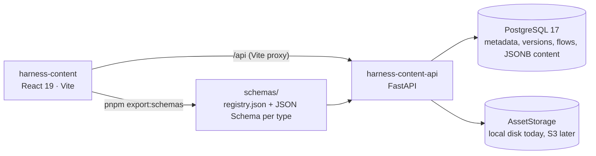

# Reusable Artifacts Studio (harness)

The studio lets authors build **reusable artifacts**: documents, slides, animations and diagrams. Each artifact is versioned per locale, reviewed before it is published, and filed in a Box → Unit → Section library. Authors then compose published artifacts into **trails**, which pin exact versions. In the API and the database a trail is called a *flow*. The product requirements are in [`apps/harness-content/docs/reusable-artifacts-prd-v0.1.md`](../apps/harness-content/docs/reusable-artifacts-prd-v0.1.md), and the phased build in [`implementation-plan.md`](../apps/harness-content/docs/implementation-plan.md).

## Shape

| Part | Where | Owns |
|---|---|---|
| Studio | `apps/harness-content` | library search, the artifact workspace (editor plus inspector), trail builder, player, review inbox |
| API | `apps/harness-content-api` | every invariant below; the UI only shows what the API allows |
| Database | Postgres via SQLAlchemy and Alembic | rows, plus database constraints that back up the versioning rules |
| Asset storage | `services/storage.py` (`AssetStorage`) | the bytes of resource files; rows hold the name, type, size, checksum and storage key |

The two apps are separate projects: neither imports the other. They share exactly two contracts: the OpenAPI schema, from which the studio generates `src/api/schema.d.ts` with `pnpm gen:api`, and the content registry, which the studio exports into the API with `pnpm export:schemas`.

## Domain

- **Artifact root** holds the metadata shared by every locale and version: title, tags, description, location, the instructional-design checklist and the **resources**.
- **Artifact version** belongs to one locale.
  - A version is a draft until it is published, and then becomes immutable.
  - Numbers are allocated `MAX+1` per (artifact, locale), so `en v2` and `pt-PT v1` can exist side by side.
  - Each locale has at most one *default* version; other published versions can stay *active*.
  - Editing a published version forks a new draft.
  - Content and the narration script are approved and published together.
- **Review** binds an approval to the draft's content hash, so any edit after approval makes it stale. Reviewers cannot approve their own submissions; admins can.
- **Flow (trail)** has draft and published *revisions*.
  - Each step pins `(artifact, locale, version)`. Publishing freezes the revision, so a published trail never changes when an artifact gets a new version.
  - The trail's "behind" report and its "use current defaults" action produce a new revision; they never rewrite an old one.
  - A revision's **outline** groups its steps: the trail holds units, a unit holds pills, and a step sits at the root, in a unit or in a pill. Reading order is play order, so step positions follow the outline. The trail, each unit and each pill carry a **rationale** (summary, objectives, prerequisites, assessment, checklist). The outline is saved with the draft and frozen on publish.
- **Archive**: an archived version stays readable through its link and in every trail that pins it, but cannot be pinned again.
- **Asset**: a resource file attached to an artifact root.
  - Markdown and text notes can be edited, with an `If-Match` revision.
  - Images and PDFs are stored as uploaded.
  - The type comes from the extension and must match the file's bytes.
  - An asset cannot be deleted while any version's content mentions its id.

Every write that changes state records an `audit_events` row. Timestamps are UTC `YYYY-MM-DD-HH-mm-ss`.

## Content and plugins

Each type is an `ArtifactPlugin` in the studio (`src/artifacts/`). A plugin has:

- a Zod schema;
- `createEmpty` and `migrate`;
- an `Editor` and a `Renderer` that work on the same JSON;
- optional inspector panels.

| Type | Content | Editor |
|---|---|---|
| doc | allowlisted BlockNote blocks, plus `callout` and `raEmbed`, which pins another artifact's version | BlockNote |
| slide | 1920×1080 elements (text, shapes, line/arrow, image, chart, embedded diagram or animation), groups, a theme | react-konva |
| animation | `{template, props}` for a registered template (`animation.reveal`, `animation.stepsDiagram`) | form generated from the props schema; Motion player |
| diagram | `{engine, theme}` plus a node graph (`flow`) or Mermaid `source` (`mermaid`) | React Flow editor and renderer; Mermaid source editor with live preview, rendered in strict mode |

`pnpm export:schemas` turns those Zod schemas into `registry.json` (the allowed components per type, plus empty content) and one JSON Schema file per type. The API checks content against them on create, import, draft save and publish:

- unknown component types are reported first, by name, with the list of supported ones;
- field errors come back as `{path, message}`.

This check is the entry point for generated content: `POST /artifacts/import` accepts JSON from any generator, and the result opens as an ordinary, editable draft.

## Access

Dev auth only: the `X-User-Id` header names a seeded user (admin, author, reviewer or viewer), and the API enforces the role matrix. Authors edit only their own drafts, and only reviewers and admins publish. Viewers read published and archived content, and can read resources too.

## Accessibility

- The studio chrome (graphite dark and light) and the six content themes meet WCAG AA text contrast. `src/lib/contrast.test.ts` checks every text-on-surface pair, and the README in `apps/harness-content` lists where the tokens differ from the design file.
- The workspace tabs follow the WAI-ARIA tab pattern. The player has keyboard controls (← → Space I O Esc) and landmarks. Artifact Preview shares its full-screen stage and the I and Esc keys.
- The main screens pass axe-core with no violations in both studio themes.

## Definition of done → tests

| PRD item | Test |
|---|---|
| 1 Published isolation | `harness-content-api/tests/test_versioning.py::test_published_isolation` |
| 2 Multiple active versions | `test_versioning.py::test_multiple_active_versions_one_default` |
| 3 Independent localization | `test_versioning.py::test_independent_locale_counters` |
| 4 Full slide editing | `harness-content/src/artifacts/plugins/slide/structure.test.ts` (`fixtures/dod4-slide.json`) |
| 5 Animation controls | `harness-content/src/artifacts/plugins/animation/animation.test.tsx` (`fixtures/dod5-animation.json`) |
| 6 Team permissions | `test_review_workflow.py::test_request_changes_then_approve_and_publish`, `::test_author_cannot_publish_or_approve` |
| 7 Flow reuse | `test_flows.py::test_flow_reuse_stays_pinned` |
| 8 Recovery (archive) | `test_flows.py::test_archived_pins_stay_playable_but_cannot_be_reused`, `test_versioning.py::test_archive_keeps_content_and_number` |

## Themes and templates

There are two theme systems. **System themes** style the studio chrome (`data-theme`, chosen in `/configuration`, stored per browser). **Artifact themes** style slides: saved rows with 16 colour slots, managed in `/artifacts-design`. Built-ins are read-only, and `slide/themes.ts` keeps them as an offline fallback. **Templates** are named slide content based on a theme; a new artifact copies the content and stays independent of the template.

## Not built yet

- Real authentication.
- S3 storage: implement `AssetStorage` and return it from `get_storage`.
- Asset references inside content: slide and doc images still take a URL, and an `` cannot send `X-User-Id`.
- Dataset and audio artifact types.
- AI generation behind the import endpoint.
