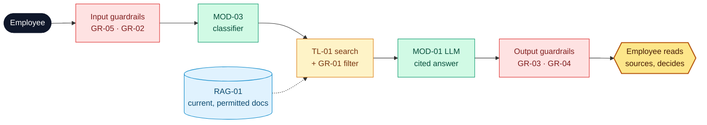

# Northstar Knowledge Assistant

**Owner:** Head of People Operations · **Version:** 1.0 · **Date:** 2026-11-04-17-00-00 UTC · Example 1 of 4 (illustrative numbers)

## 1. Problem

> **Northstar employees** struggle to **find the current rule or procedure** because **policies and manuals exist in conflicting, outdated versions**, resulting in **≈ 540 h a month (€21.6k) lost searching and 22 % of answers based on a superseded document**.

**Scope:** internal Q&A over HR policies, product manuals and procedures. **Non-goals:** changing policies, personal records, any write action.

## 2. Solution: cited answers from current sources only, or an honest "I don't know"

| Component | Used for | Catalog ID |
| --- | --- | --- |
| RAG index (hybrid, version + access metadata) | Current, permitted evidence only | RAG-01 |
| Tools (read-only) | Search, exact excerpt, version diff | TL-01, TL-02, TL-03 |
| Models | Classifier routes; LLM writes the cited answer | MOD-03, MOD-01 |
| Workflow | Classify → filter → retrieve → answer → validate | WF-01, WF-02 |

| # | Use case | Target user | Priority |
| --- | --- | --- | --- |
| UC1 | Policy Q&A, version-aware | Employee | ★ riskiest |
| UC2 | Product troubleshooting lookup | Support analyst | High |
| UC3 | Policy change comparison | Content owner | Medium |
| UC4 | Abstention and gap report | Employee → content owner | High |

## 3. Risks and guards

| Risk | Guard |
| --- | --- |
| Stale policy stated as current | `GR-01` effective-date filter in code; version fixtures at 100 % (`EV-04`) |
| Invented or unsupported answer | `GR-03`: every claim must cite a retrieved chunk ID; `GR-04` abstains below τ |
| Unauthorised document exposed | `GR-01` access-group filter before retrieval; 100 % on auth fixtures |

**Key assumption:** document version and date metadata is correct. Ingestion (`WF-03`) rejects documents that lack it.

## 4. Evals

| Measure | Metric | Baseline → target / threshold |
| --- | --- | --- |
| Value | Time to a trusted answer | 18 min → ≤ 3 min |
| Quality | Retrieval recall@5 · citation validity · correct abstention | ≥ 85 % · ≥ 90 % · ≥ 90 % |
| Adoption | Questions answered through the assistant | 0 % → ≥ 60 % |

**Evidence so far:** the prototype passes the version and abstention fixtures on a 40-question gold set. Time saved and adoption are still hypotheses.
**Decision asked:** the **COO** approves a **6-week pilot** (120 users, ≈ €18k) by **2026-11-30-17-00-00 UTC**.
