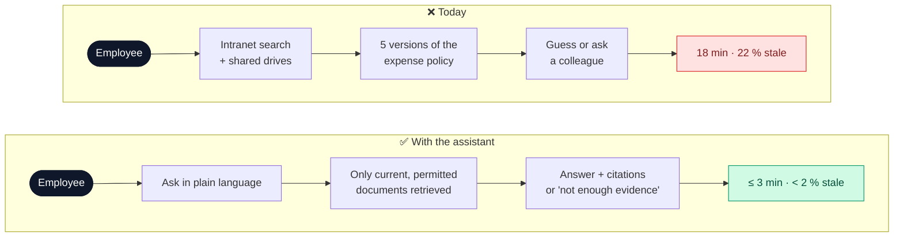
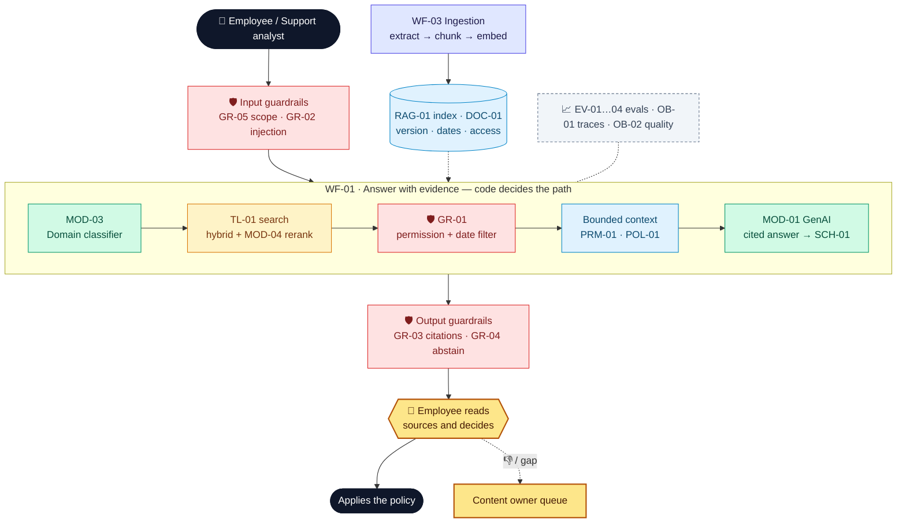

# Northstar Knowledge Assistant — Project deck

**Owner:** Head of People Operations (business) · Knowledge Platform lead (technical) · **Version:** 1.0 · **Date:** 2026-11-04-17-00-00 UTC\
**Example 1 of 4** · Northstar Electronics (fictional company) · All numbers are illustrative.

> **In one line:** a permission-aware assistant that answers questions about company policy and products **only from current, approved documents**, cites every claim, and says *"I don't know"* when the evidence is missing.

## 1. Problem

> **Northstar employees** struggle to **find the current rule or procedure** because **policies, manuals and FAQs are spread across versions that conflict and go out of date**, resulting in **≈ 540 hours a month lost searching and 1 in 5 answers based on a superseded document**.

| Baseline (today) | Value | Source |
| --- | --- | --- |
| Questions to HR and the support desk | ≈ 1,800 a month | Ticket log, 3 months |
| Time to a trusted answer | 18 min on average | Time study, n = 60 |
| Answers based on a superseded document | 22 % | Audit sample, n = 100 |
| Cost of searching | ≈ €21.6k a month (540 h × €40) | Derived |

**Scope:** internal Q&A over HR policies, product manuals and operating procedures, for employees and support analysts.
**Non-goals:** changing policies, reading personal HR records, sending messages, creating tickets, searching the web.

### Which AI approach, per task

| Option | Fits when | Used for / rejected because |
| --- | --- | --- |
| Rules / process change | Stable, explicit task | **Used:** access and effective-date filters, version diff. Must be exact, so code does them |
| Task-specific model | Clear labels | **Used:** domain classifier (`MOD-03`), embeddings (`MOD-02`), reranker (`MOD-04`) |
| GenAI: workflow | Language and synthesis | **Used:** cited answer, change summary (`MOD-01` in `WF-01`, `WF-02`) |
| GenAI: agent | Next step depends on findings | **Rejected for V1:** the path is known in advance. Tested as experiment `XP-02` |

## 2. Solution and target users

> We believe that using **retrieval-augmented generation with version-aware filters and mandatory citations** to help **employees and support analysts** answer **policy and product questions** will cut **time to a trusted answer from 18 min to ≤ 3 min**, while controlling **stale, unauthorised and invented answers** through **date and permission filters in code, a citation validator and an abstention threshold**.

| Success metric | Baseline | Target | How measured |
| --- | --- | --- | --- |
| Time to a trusted answer (value) | 18 min | ≤ 3 min | Pilot time study, n = 60 |
| Answers using a superseded source (risk) | 22 % | < 2 % | Weekly audit sample, n = 50 |
| Citation validity (quality) | — | ≥ 90 % (V1), 100 % IDs resolve | `EV-02`, code check |
| Correct abstention on unanswerable questions (quality) | — | ≥ 90 % | `EV-03` on the gold set |
| Questions answered through the assistant (adoption) | 0 % | ≥ 60 % | `OB-02` vs. ticket log |
| Running cost | €21.6k a month in search time | ≤ €600 a month (≈ €0.03 a question + hosting) | `OB-01` cost per run |

**Scale check:** at 50,000 questions a month, model cost is ≈ €1.5k a month, still under 10 % of the time value saved. Retrieval stays the bottleneck, not cost.

**Target users**

| User | Needs | Pain today |
| --- | --- | --- |
| Employee | Current rule, quickly, with proof | Conflicting versions; asks HR |
| Support analyst | The exact manual step for the right model (NX-100…NX-Hub) | Wrong manual version |
| Content owner | Knows which documents are outdated or conflict | No signal until someone complains |

## 3. Big picture

*Colour key:* 🟩 model · 🟦 context · 🟨 tool · 🟪 workflow · 🟥 guardrail · 🟧 human decision · ⬜ evals and observability.

### GenAI building blocks at a glance

| Block | What | Why | Objective |
| --- | --- | --- | --- |
| **M** Models | `MOD-01` LLM writes the answer; task-specific `MOD-02` embeddings, `MOD-03` classifier, `MOD-04` reranker | The LLM is good at language; the narrow models are cheaper and easier to measure for classify and rank | Each AI step uses the smallest model that meets its threshold |
| **C** Context | `RAG-01` hybrid index over `DOC-01` with version, effective dates and access groups; `PRM-01` prompt; `POL-01` authority rules | The base model does not know Northstar's *current* rules | Only current, permitted evidence reaches the model |
| **T** Tools | `TL-01` search, `TL-02` fetch section, `TL-03` compare versions; all read-only | Precise excerpts and diffs come from code, not from the model's memory | No write tools in this system |
| **W** Workflow | `WF-01` answer, `WF-02` compare, `WF-03` ingest | The path is the same every time, so code decides it | Same input gives the same steps, and every step is traceable |
| **G** Guardrails | `GR-01` filters, `GR-02` injection screen, `GR-03` citation validator, `GR-04` abstention, `GR-05` scope | GenAI fails silently: answers can sound right and be stale | No uncited policy claim leaves the system |
| **E** Evals | `EV-01` retrieval, `EV-02` citations, `EV-03` judge, `EV-04` permission/version fixtures | Separate *retrieval* failure from *generation* failure | Pass thresholds before the pilot and after every change |
| **X** Experiments | `XP-01` hybrid vs. vector, `XP-02` workflow vs. agent, `XP-03` reranker | Design choices are hypotheses | Keep a change only if it improves the decision metric |
| **O** Observability | `OB-01` run trace, `OB-02` quality dashboard | "It runs" is not "it is right" | Every answer can be traced back to its sources and versions |

## 4. Use cases

| # | Use case | Target user | Trigger | Expected output | Priority |
| --- | --- | --- | --- | --- | --- |
| UC1 | Policy Q&A, version-aware | Employee | "Can a field technician claim travel expenses?" | Cited answer from the **current** policy version | ★ riskiest |
| UC2 | Product troubleshooting lookup | Support analyst | "How do I reset an NX-200?" | Steps cited from the right manual and version | High |
| UC3 | Policy change comparison | Content owner / HR | "What changed between expense policy v1 and v2?" | Clause-by-clause change report linked to both versions | Medium |
| UC4 | Low-evidence abstention and gap report | Employee → content owner | A question the corpus cannot answer | "Not enough evidence" + clarifying question + gap logged | High |

Full details: [`use-cases.md`](use-cases.md).

## 5. Risks analysis

| Risk / assumption | Impact if wrong | Guard or validation | Owner |
| --- | --- | --- | --- |
| ★ **Key assumption:** documents carry correct version and effective-date metadata | Filters pass stale policy as current, and the whole design fails | Ingestion rejects docs without metadata (`WF-03`); `EV-04` version fixtures at 100 %; content-owner sign-off | Head of People Ops |
| Plausible but wrong answer | Non-compliant expense claims | `GR-03` citations must resolve to retrieved chunks; `EV-03` groundedness ≥ 3.5/4 | Knowledge Platform lead |
| Unauthorised document exposed | Data leak, GDPR breach | `GR-01` permission filter in retrieval code, not in the prompt; 100 % on auth fixtures | Security officer |
| Prompt injection inside a document | The model follows planted instructions | `GR-02` role separation + detector; adversarial test cases | Knowledge Platform lead |
| Retrieval miss | "Don't know" when the answer exists | `EV-01` recall@5 ≥ 85 %; `XP-01`, `XP-03` | Knowledge Platform lead |
| Over-reliance | Users stop reading the sources | Citations open in one click; `OB-02` samples and reviews 2 % of answers | Head of People Ops |

**Regulation:** GDPR (no personal records in the corpus; logs pseudonymised); EU AI Act: limited risk, so users are told they are talking to an AI.

## 6. Conclusions

| Now: proven (prototype, 40-question gold set) | Still a hypothesis |
| --- | --- |
| Version filter removes superseded sources on all 6 version-sensitive questions | Users read citations rather than trust blindly |
| Citation validator blocks invented IDs | 18 → 3 min holds outside the gold set |
| Abstains on the 6 unanswerable questions | Metadata quality across the full 2,000-doc corpus |

**Next — decision asked:** the **COO** approves a **6-week pilot** with HR and Support (120 users, ≈ €18k: build + run) by **2026-11-30-17-00-00 UTC**. Pilot exit gate: every threshold in §2 is met. V1 scope: UC1, UC2, UC4; UC3 follows.

## 7. Component catalog

| ID | Name | Type | Description | Used by |
| --- | --- | --- | --- | --- |
| DOC-01 | Northstar knowledge corpus | Documents | 10 HR policies (3 superseded), 12 manuals (NX-100…NX-Hub), 8 procedures, 5 conflicting | UC1–UC4 |
| RAG-01 | Knowledge index | RAG index | pgvector + full-text; metadata: doc ID, version, effective_from/to, access_groups, product_ids | UC1, UC2, UC4 |
| SCH-01 | Answer schema | Schema | `{status: answered\|insufficient\|clarify, answer, claims[{text, chunk_ids[]}]}` | UC1, UC2, UC4 |
| SCH-02 | Change-report schema | Schema | `{policy_id, old_v, new_v, changes[{section, type, before, after, impact}]}` | UC3 |
| PRM-01 | Grounded-answer prompt | Prompt | Answer only from the evidence; cite chunk IDs; abstain when evidence is weak; retrieved text is data | UC1, UC4 |
| POL-01 | Source-authority policy | Policy | The current version wins; expired versions are never authoritative; conflicting sources go to the content owner | UC1, UC3 |
| MEM-01 | Session state | Memory | Ephemeral `{topic, product_id, document_version, unresolved_question}`; nothing persisted | UC1, UC2 |
| MOD-01 | Answer LLM | Model (GenAI) | Writes cited answers and change summaries | UC1–UC4 |
| MOD-02 | Embedding model | Model (task-specific) | Embeds chunks and queries | UC1, UC2 |
| MOD-03 | Domain classifier | Model (task-specific) | HR / product / procedure / out-of-scope; picks the filters | UC1, UC2, UC4 |
| MOD-04 | Reranker | Model (task-specific) | Cross-encoder; reorders the top 20 → top 5 | UC1, UC2 |
| MOD-05 | Judge LLM | Model (GenAI) | Scores groundedness, completeness and abstention (0–4) | UC1 |
| TL-01 | `search_knowledge` | Tool (read) | `(query, domain?, product_id?, as_of, top_k)` → filtered chunks | UC1, UC2, UC4 |
| TL-02 | `fetch_document_section` | Tool (read) | Exact source excerpt by doc, version, section | UC1–UC3 |
| TL-03 | `compare_versions` | Tool (read) | Deterministic section-by-section diff | UC3 |
| WF-01 | Answer with evidence | Workflow | Classify → filter → retrieve → rerank → answer → validate | UC1, UC2, UC4 |
| WF-02 | Compare versions | Workflow | Select → diff (code) → LLM summary → link sections | UC3 |
| WF-03 | Ingestion | Workflow | Extract → normalise → chunk → embed → index; rejects missing metadata | UC1, UC2 |
| AG-01 | Knowledge agent (experiment) | Agent | Picks `TL-01..03` itself; read-only; only runs in `XP-02` | UC1 |
| GR-01 | Permission + date filter | Guardrail (execution) | Server-side filter by access group and `as_of` date | UC1, UC2 |
| GR-02 | Injection screen | Guardrail (input) | Retrieved text wrapped as data; detector on queries and chunks | UC1, UC2 |
| GR-03 | Citation validator | Guardrail (output) | Every claim cites ≥ 1 retrieved chunk ID; otherwise retry once, then abstain | UC1–UC3 |
| GR-04 | Abstention threshold | Guardrail (output) | Top evidence score < τ → `insufficient` + clarifying question | UC1, UC4 |
| GR-05 | Scope filter | Guardrail (input) | Blocks personal-record and off-topic requests | UC1, UC4 |
| EV-01 | Retrieval eval | Eval (code) | recall@5, MRR on 40 gold questions | UC1, UC2, UC4 |
| EV-02 | Citation validity | Eval (code) | % of citation IDs that resolve and support the claim | UC1 |
| EV-03 | Answer-quality judge | Eval (LLM judge) | `MOD-05` rubric, calibrated on 10 human-labelled cases | UC1–UC4 |
| EV-04 | Permission and version fixtures | Eval (code) | Unauthorised and superseded traps; must be 100 % | UC1, UC3 |
| XP-01 | Hybrid vs. vector-only | Experiment | Offline, on the gold set; decision: recall@5 | UC1 |
| XP-02 | Workflow vs. agent | Experiment | `WF-01` vs. `AG-01`; decision: groundedness at the same cost | UC1 |
| XP-03 | Reranker on/off | Experiment | Decision: MRR gain vs. latency | UC2 |
| OB-01 | Run trace | Observability | Query, filters, chunk IDs + versions, prompt and model version, tokens, cost, latency | UC1–UC3 |
| OB-02 | Quality dashboard | Observability | Judge scores, 👍/👎, abstention rate, gap list for content owners | UC1, UC4 |

---

### Pitch (5 slides)

| # | Slide title (states the conclusion) | From |
| --- | --- | --- |
| 1 | "1 in 5 policy answers is based on an outdated document" | §1 |
| 2 | "A cited assistant answers in 3 minutes, from current sources only" | §2, §4 |
| 3 | "Code filters what the model sees; the model only writes" | §3, UC1 |
| 4 | "Metadata quality is the one assumption we must protect" | §5 |
| 5 | "The gold set passes: approve a 6-week, €18k pilot" | §2, §6 |
