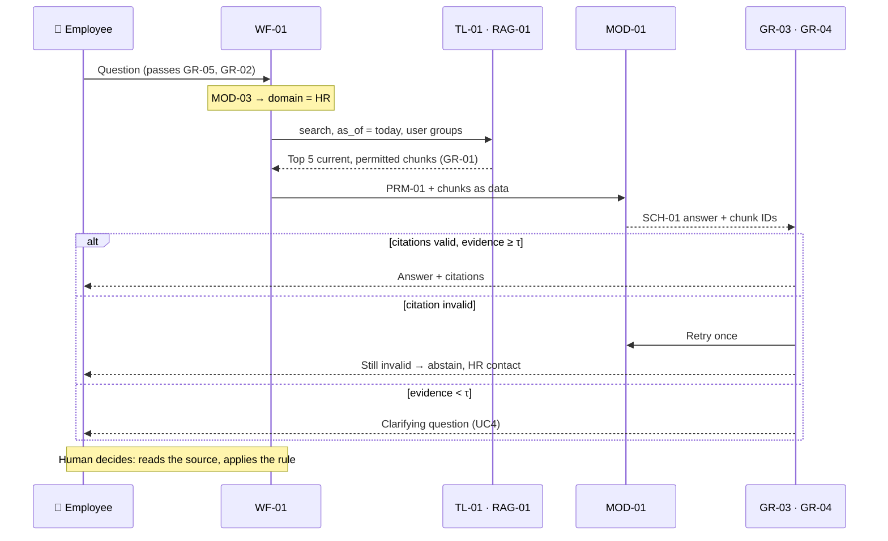

# Northstar Knowledge Assistant — Use cases

**Appendix to the project deck** · Version 1.0 · 2026-11-04-17-00-00 UTC\
Component IDs refer to the catalog (project deck, §7). ★ = riskiest use case, designed and prototyped first.

| # | Use case | Pattern | Autonomy | Priority |
| --- | --- | --- | --- | --- |
| UC1 | Policy Q&A, version-aware | Workflow `WF-01` | Suggests; the employee decides | ★ riskiest |
| UC2 | Product troubleshooting lookup | Workflow `WF-01` | Suggests; the analyst decides | High |
| UC3 | Policy change comparison | Workflow `WF-02` | Suggests; the content owner validates | Medium |
| UC4 | Low-evidence abstention and gap report | Workflow `WF-01` (abstain branch) | Acts alone (logs the gap) | High |

---

## UC1 ★ Policy Q&A, version-aware

### 1. Story

> "As an **employee**, when **I need to know whether an expense or a leave rule applies to me**, I want **a short answer quoting the current policy clause**, so that **I act correctly without opening five PDFs or waiting for HR**."

### 2. User flow

| Step | Human | AI | Tool / system | Autonomy |
| --- | --- | --- | --- | --- |
| 1 | Asks the question | — | `GR-05`, `GR-02` | — |
| 2 | — | Classifies the domain (`MOD-03`) | — | Acts alone (internal) |
| 3 | — | — | `TL-01` with `GR-01` filters | Code |
| 4 | — | Drafts a cited answer (`MOD-01`) | — | Suggests |
| 5 | — | — | `GR-03`, `GR-04` validate | Code |
| 6 | **Reads the sources and decides** | — | Citation opens `TL-02` excerpt | Human |

**On failure:** retrieval timeout → retry once, then "service unavailable, contact HR"; validator fails twice → abstain; conflicting current sources → show both and route to the content owner (`POL-01`).

### 3. Context

| Step | Need | Component | Freshness & access |
| --- | --- | --- | --- |
| 3 | Policy chunks | `RAG-01` over `DOC-01`, built by `WF-03` | Re-indexed on publish (≤ 1 h); filtered by `access_groups` and `as_of` |
| 4 | Instructions | `PRM-01`, `POL-01` | Versioned in git; version logged in `OB-01` |
| 4 | Conversation state | `MEM-01` | Session only; **no** personal data stored |
| 5 | Output contract | `SCH-01` | Validated by code |

Context budget: top 5 chunks (≈ 2.5k tokens). Relevance beats volume.

### 4. Tools

| Tool | Purpose | Read / act |
| --- | --- | --- |
| `TL-01` `search_knowledge` | Filtered hybrid retrieval | Read |
| `TL-02` `fetch_document_section` | Exact excerpt behind each citation | Read |

The model only *requests* a search. Code fills `as_of` and `groups` from the session, never from the model, and rejects `top_k` > 10. No act tools: the assistant never changes a policy or files a claim.

### 5. Flow and models

**Workflow** (`WF-01`): the steps are known in advance, so code decides them. An agent (`AG-01`) is tested only in `XP-02`.

| AI step | Model | Why this model |
| --- | --- | --- |
| Domain routing | `MOD-03` classifier | Narrow 4-class task; cheap and measurable (accuracy ≥ 95 %) |
| Retrieval | `MOD-02` embeddings + `MOD-04` reranker | Semantic match plus precise ordering |
| Answer | `MOD-01` LLM | Language synthesis with citations |

### 6. Guardrails

| Input | Execution | Output |
| --- | --- | --- |
| `GR-05` blocks personal-record requests ("show Ana's salary"); `GR-02` flags injected text in queries and chunks | `GR-01` filters by access group and effective date **in code**, before the model sees anything | `GR-03` every claim cites a retrieved chunk; `GR-04` abstains below τ; safe fallback = HR contact |

False alarms are tested too: `GR-05` must not block "how many leave days do I have under the policy?".

### 7. Evals

Test set: 40 gold questions: 20 normal, 8 hard (multi-document), 6 edge (version-sensitive), 6 adversarial (unanswerable or injected).

| Dimension | Metric | Evaluator | Threshold |
| --- | --- | --- | --- |
| Retrieval | recall@5 / MRR | `EV-01` code | ≥ 85 % / ≥ 0.7 |
| Correctness | Answer matches the reference rubric | `EV-03` judge (`MOD-05`), calibrated on 10 human labels | ≥ 3.5 / 4 |
| Groundedness | Citation IDs resolve and support the claim | `EV-02` code + judge | 100 % resolve; ≥ 90 % support |
| Policy | Superseded or unauthorised source used | `EV-04` code | 0 |

### 8. Observability

| Signal | What is logged | Alert / review trigger |
| --- | --- | --- |
| Traces | Query (pseudonymised), filters, chunk IDs + versions, prompt and model version (`OB-01`) | Any answer citing an expired version |
| Speed, errors, cost | p95 latency, retries, tokens, € per answer | p95 > 6 s; cost > €0.05 per answer |
| Quality | Judge score on a 2 % sample, 👍/👎 (`OB-02`) | Weekly judge mean < 3.5; 👎 rate > 10 % |

Every 👎 with a reason becomes a gold-set candidate.

### 9. Experiments

| Hypothesis | Variant vs. baseline | Dataset | Decision metric |
| --- | --- | --- | --- |
| Hybrid search finds policy codes that vectors miss | `XP-01` hybrid vs. vector-only | 40 gold questions | recall@5 +5 pts |
| An agent finds multi-doc answers better | `XP-02` `AG-01` vs. `WF-01` | 8 hard questions | Groundedness at ≤ 1.5× cost |

### 10. Risks and open questions

- Two "current" versions overlap in dates → both shown; does `POL-01` cover every case? (Owner: Head of People Ops.)
- Users may stop reading citations → measure the citation-click rate in the pilot.
- Is τ (abstention threshold) too strict? Tune it on the gold set; watch the abstention rate in `OB-02`.

---

## UC2 Product troubleshooting lookup

**1. Story:** "As a **support analyst**, when **a customer reports an NX-200 that will not boot**, I want **the reset steps from the right manual version**, so that **I fix it on the first call**."

**2. User flow**

| Step | Human | AI | Tool / system | Autonomy |
| --- | --- | --- | --- | --- |
| 1 | Asks; picks the product if prompted | `MOD-03` → domain = product | — | Suggests |
| 2 | — | — | `TL-01` filtered by `product_id` + `GR-01` | Code |
| 3 | — | `MOD-01` writes numbered steps with citations | `GR-03` | Suggests |
| 4 | **Follows or rejects the steps** | — | `TL-02` opens the manual page | Human |

Product ambiguous ("my NX") → clarifying question, not a guess.

**3. Context:** `RAG-01` over the 12 manuals in `DOC-01` (`product_ids` metadata; re-indexed by `WF-03` on publish); `MEM-01` keeps `product_id` for follow-ups; output `SCH-01`.

**4. Tools:** `TL-01`, `TL-02` (read). No ticket tool here: that is Example 2.

**5. Flow and models:** `WF-01`; `MOD-02` + `MOD-04` for ranking (procedure steps are lexically close across models); `MOD-01` formats the steps.

**6. Guardrails:** `GR-02` on manual text; `GR-03` citations; product mismatch between query and chunk → block.

**7. Evals:** 12 gold questions in `EV-01`; wrong-product citation = 0 (code); step completeness ≥ 3.5/4 (`EV-03`).

**8. Observability:** `OB-01` product ID per run; alert when the same product gets 👎 three times in a week.

**9. Experiments:** `XP-03` reranker on/off; decision = MRR gain ≥ 0.05 with p95 latency still within 6 s.

**10. Risks:** manuals for old firmware are still "current" for old units → is `as_of` the right filter, or should it be the firmware version? (Open.)

---

## UC3 Policy change comparison

**1. Story:** "As a **content owner**, when **a new expense policy version is published**, I want **a clause-by-clause change report**, so that **I can tell employees exactly what changed**."

**2. User flow**

| Step | Human | AI | Tool / system | Autonomy |
| --- | --- | --- | --- | --- |
| 1 | Picks the policy and two versions | — | — | — |
| 2 | — | — | `TL-03` deterministic diff | Code |
| 3 | — | `MOD-01` summarises the impact of each change → `SCH-02` | `GR-03` | Suggests |
| 4 | **Validates and publishes the notice** | — | — | Human |

**3. Context:** both versions of the `DOC-01` policy via `TL-02`; `POL-01` decides which is authoritative; output `SCH-02`.

**4. Tools:** `TL-02`, `TL-03` (read). **5. Flow:** `WF-02`. The diff is code (exact); the LLM only explains it, because a model diff would miss clauses.

**6. Guardrails:** every change item must map to a diff hunk (`GR-03`); no hunk left unexplained.

**7. Evals:** 3 seeded policy pairs; diff recall 100 % (code); summary faithfulness ≥ 3.5/4 (`EV-03`); `EV-04` version fixtures.

**8. Observability:** `OB-01` logs the versions compared. **9. Experiments:** none for V1: the diff is deterministic and there is one design.

**10. Risks:** reformatted but unchanged clauses show up as noise → normalise whitespace before the diff.

---

## UC4 Low-evidence abstention and gap report

**1. Story:** "As an **employee**, when **the policies do not cover my question**, I want **to be told so, with a next step**, so that **I do not act on an invented rule**. As a **content owner**, I want **those gaps listed**."

**2. User flow**

| Step | Human | AI | Tool / system | Autonomy |
| --- | --- | --- | --- | --- |
| 1 | Asks | `MOD-03` routes | `TL-01` | — |
| 2 | — | — | `GR-04`: evidence score < τ | Code |
| 3 | — | `MOD-01` writes a clarifying question | `SCH-01` `status=insufficient` | Suggests |
| 4 | Clarifies or contacts HR | — | Gap logged to `OB-02` | Acts alone (logging) |
| 5 | **Content owner triages the gap list weekly** | — | — | Human |

**3. Context:** `RAG-01` over `DOC-01`, `SCH-01`, `PRM-01` (the abstention instruction). **4. Tools:** `TL-01` (read). Logging is internal, not a tool.

**5. Flow:** `WF-01` abstain branch. The decision to abstain is a **threshold in code**, not the model's choice.

**6. Guardrails:** `GR-04` threshold; `GR-05` scope; output never contains a policy claim without a citation.

**7. Evals:** 6 unanswerable + 4 near-miss questions; correct abstention ≥ 90 %; false abstention on answerable questions ≤ 5 % (`EV-03`, `EV-01`).

**8. Observability:** abstention rate per domain; a spike means a missing document or a broken index.

**9. Experiments:** τ sweep (0.3–0.6) on the gold set; decision = best balance of correct and false abstention.

**10. Risks:** too many abstentions → users give up. The pilot target is an abstention rate < 15 % on real traffic.
