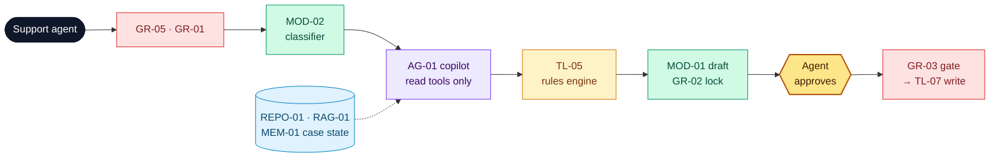

# Northstar Service Desk Copilot

**Owner:** Head of Customer Service · **Version:** 1.0 · **Date:** 2026-11-04-17-00-00 UTC · Example 2 of 4 (illustrative numbers)

## 1. Problem

> **Support agents** struggle to **resolve warranty and order cases consistently** because **they combine five systems by hand and lose context between sessions**, resulting in **14 min per case, 9 % inconsistent warranty decisions and 12 % reopened cases (≈ €42k a month)**.

**Scope:** warranty, order-status and troubleshooting cases. **Non-goals:** unattended refunds, policy changes, unreviewed customer messages.

## 2. Solution: the copilot reads, rules decide, the agent approves, the workflow writes

| Component | Used for | Catalog ID |
| --- | --- | --- |
| Records + knowledge index + case memory | Authoritative facts; policy wording; state across sessions | REPO-01, RAG-01, MEM-01 |
| Tools | Read records; compute eligibility; propose; commit (approved) | TL-01…08 |
| Models | Classifier routes; LLM picks tools and drafts | MOD-02, MOD-01 |
| Workflow / agent | Fixed stages, with a bounded read-only agent step | WF-01, AG-01 |

| # | Use case | Target user | Priority |
| --- | --- | --- | --- |
| UC1 | Warranty eligibility claim | Support agent | ★ riskiest |
| UC2 | Where is my order? | Support agent | High |
| UC3 | Troubleshoot and escalate | Support agent | Medium |
| UC4 | Resume an interrupted case | Next-shift agent | High |

## 3. Risks and guards

| Risk | Guard |
| --- | --- |
| Another customer's data exposed | `GR-01` backend ownership check on every read; 100 % denial on fixtures |
| Model overrides eligibility | `TL-05` rules decide; `GR-02` blocks drafts that contradict the result or its rule IDs |
| Duplicate or silent write | `GR-03` approval token + idempotency key; success shown only from the receipt |

**Key assumption:** the warranty rules fit an explicit table (`POL-01`). Cases outside it go to the team lead.

## 4. Evals

| Measure | Metric | Baseline → target / threshold |
| --- | --- | --- |
| Value | Average handling time · reopen rate | 14 → ≤ 6 min · 12 → ≤ 6 % |
| Quality | Eligibility = oracle · tool accuracy · unsafe actions | 100 % · ≥ 85 % · 0 |
| Adoption | Proposals approved without edits | ≥ 70 % |

**Evidence so far:** on 35 gold cases there are 0 leaks and 0 duplicate writes, eligibility matches the oracle on 18/18, and resume after restart is exact. Time saved is still a hypothesis.
**Decision asked:** the **Head of Customer Service** approves a **4-week pilot** (4 agents, ≈ €22k) by **2026-12-04-17-00-00 UTC**.
