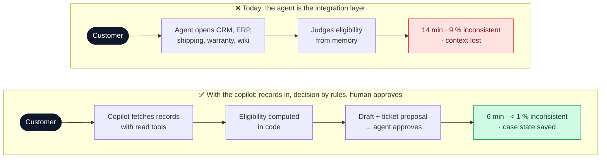
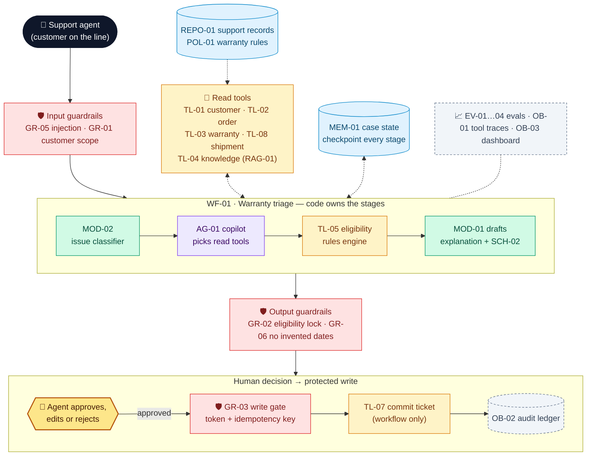

# Northstar Service Desk Copilot — Project deck

**Owner:** Head of Customer Service (business) · Support Platform lead (technical) · **Version:** 1.0 · **Date:** 2026-11-04-17-00-00 UTC\
**Example 2 of 4** · Northstar Electronics (fictional company) · Builds on Example 1 (reuses the knowledge index) · All numbers are illustrative.

> **In one line:** a copilot that pulls the customer's records, applies the warranty rules **in code**, drafts the resolution, and only writes a ticket **after the agent approves it**, so that no case is ever lost.

## 1. Problem

> **Support agents** struggle to **resolve warranty and order cases consistently** because **they combine five systems by hand and context is lost between sessions**, resulting in **14 min per case, 9 % inconsistent warranty decisions and a 12 % reopen rate**.

| Baseline (today) | Value | Source |
| --- | --- | --- |
| Cases a month (8 agents) | ≈ 4,200 | Ticket system, 3 months |
| Average handling time (AHT) | 14 min | Time study, n = 80 |
| Inconsistent warranty decisions | 9 % | QA audit, n = 150 |
| Reopened cases | 12 % | Ticket system |
| Cost | ≈ €34k a month in handling time + ≈ €8k a month in unwarranted replacements | Derived |

**Scope:** warranty, order-status and troubleshooting cases handled by support agents.
**Non-goals:** unattended refunds or payments, changing warranty policy, sending customer messages without review.

### Which AI approach, per task

| Option | Fits when | Used for / rejected because |
| --- | --- | --- |
| Rules / process change | Stable, explicit task | **Used:** warranty eligibility (`TL-05`), authorisation, idempotent writes. These are money and permissions, so the model never decides them |
| Task-specific model | Clear labels | **Used:** issue classifier and symptom codes (`MOD-02`), trained on 18 months of tickets |
| GenAI: workflow | Language and synthesis | **Used:** understand the customer's words, draft the explanation and the ticket (`MOD-01`) |
| GenAI: agent | Next step depends on findings | **Used, bounded:** `AG-01` picks *read* tools inside a workflow step; it **cannot write** |

## 2. Solution and target users

> We believe that using **a tool-using copilot inside a code-controlled workflow, with deterministic eligibility rules and structured case memory,** to help **support agents** resolve **warranty and order cases** will cut **handling time from 14 to 6 min and inconsistent decisions from 9 % to < 1 %**, while controlling **data leaks, wrong eligibility and silent writes** through **backend ownership checks, a rules engine the model cannot override, and an approval and idempotency gate on every write**.

| Success metric | Baseline | Target | How measured |
| --- | --- | --- | --- |
| Average handling time (value) | 14 min | ≤ 6 min | `OB-03`, pilot vs. control group |
| Inconsistent warranty decisions (risk) | 9 % | < 1 % | QA audit, n = 100 |
| Reopened cases (value) | 12 % | ≤ 6 % | Ticket system |
| Correct tool choice and arguments (quality) | — | ≥ 85 % | `EV-02` on 35 gold cases |
| Unauthorised reads, unapproved or duplicate writes (safety) | — | 0 | `EV-01` hard-constraint suite |
| Proposals approved without edits (adoption) | — | ≥ 70 % | `OB-02` audit ledger |
| Running cost | €42k a month | ≈ €0.08 a case → ≈ €350 a month + €600 hosting | `OB-01` |

**Scale check:** at 50,000 cases a month the model cost is ≈ €4k a month. The rules engine and the write gate do not change with volume.

**Target users**

| User | Needs | Pain today |
| --- | --- | --- |
| Support agent | One view of customer, order, warranty and policy; a draft to approve | Five tabs, no memory between shifts |
| Team lead | Audit why a claim was accepted or denied | Decisions live in free-text notes |
| Customer (indirect) | Consistent, fast and correct answers | Different answer from each agent |

## 3. Big picture

*Colour key:* 🟩 model · 🟦 context · 🟨 tool · 🟪 agent · 🟥 guardrail · 🟧 human decision · ⬜ evals and observability.

### GenAI building blocks at a glance

| Block | What | Why | Objective |
| --- | --- | --- | --- |
| **M** Models | `MOD-01` LLM understands the customer and drafts; task-specific `MOD-02` classifies the issue and symptom codes; `MOD-03` judge | Classifying is narrow and labelled, so a small model is cheaper and measurable | Classifier accuracy ≥ 92 %; LLM used only for language |
| **C** Context | `REPO-01` records, `POL-01` rule table, `RAG-01` manuals and policies (Example 1), `MEM-01` case state, `MEM-02` case summaries, `PRM-01` | Records are authoritative; documents explain; memory keeps the case alive across sessions | Every fact in a draft traces to a record ID or a chunk ID |
| **T** Tools | Read `TL-01..04`, `TL-08`; compute `TL-05`; propose `TL-06`; commit `TL-07` | The model cannot know order status or compute dates safely | Typed JSON in and out; arguments validated by code |
| **W** Workflow | `WF-01` warranty triage, `WF-02` troubleshoot and escalate, `WF-03` resume | Stages and writes must follow a fixed, auditable order | No stage is skipped; every stage is checkpointed |
| **A** Agent | `AG-01` copilot, a bounded loop over **read** tools only (max 6 calls) | Which record to fetch next depends on what it finds | Correct tool choice ≥ 85 %; zero write authority |
| **G** Guardrails | `GR-01` ownership, `GR-02` eligibility lock, `GR-03` write gate, `GR-04` argument checks, `GR-05` injection, `GR-06` no invented dates, `GR-07` PII masking | A fluent answer can still leak, misjudge or write twice | Hard constraints hold 100 % of the time |
| **E** Evals | `EV-01` hard constraints, `EV-02` tool use, `EV-03` workflow and state, `EV-04` reply judge | Judge action safety separately from fluency | Pass before the pilot and after every change |
| **X** Experiments | `XP-01` memory vs. chat replay, `XP-02` classifier vs. LLM routing, `XP-03` small vs. large model | Cost and reliability trade-offs | Change only what wins on the gold cases |
| **O** Observability | `OB-01` tool trace, `OB-02` audit ledger, `OB-03` dashboard | Accountability for every write | Any ticket can be traced to its proposal, approver and evidence |

## 4. Use cases

| # | Use case | Target user | Trigger | Expected output | Priority |
| --- | --- | --- | --- | --- | --- |
| UC1 | Warranty eligibility claim | Support agent | "My NX-200 stopped charging" | Eligibility (by rules) + explanation + ticket proposal, approved by the agent | ★ riskiest |
| UC2 | Where is my order? | Support agent | "Where is order ORD-10442?" | Status and delay reason from shipping records; never an invented date | High |
| UC3 | Troubleshoot and escalate | Support agent | A symptom the customer describes | Guided steps from the manuals → resolved, or an escalation ticket after consent | Medium |
| UC4 | Resume an interrupted case | Support agent (next shift) | Agent reopens case CASE-0312 | The same stage, facts and pending proposal; no duplicate write | High |

Full details: [`use-cases.md`](use-cases.md).

## 5. Risks analysis

| Risk / assumption | Impact if wrong | Guard or validation | Owner |
| --- | --- | --- | --- |
| ★ **Key assumption:** warranty rules can be written as an explicit rule table (`POL-01`) | Eligibility returns to judgement calls and the 9 % inconsistency stays | Encode the 14 current rules with legal; boundary tests on dates; out-of-table cases go to the team lead | Head of Customer Service |
| Another customer's data exposed | GDPR breach | `GR-01` backend ownership check on every read; 100 % denial on fixtures | Security officer |
| Model overrides the eligibility result | Unfair denial or free replacement | `GR-02`: the draft must match the `TL-05` result and rule IDs, otherwise it is blocked | Support Platform lead |
| Duplicate or silent write | Double tickets, false "done" | `GR-03` approval token + idempotency key; success shown only from the transaction receipt | Support Platform lead |
| Lost case state | Rework, angry customer | `MEM-01` checkpoint per stage, schema-versioned; resume test (`EV-03`) | Support Platform lead |
| Over-reliance: rubber-stamp approvals | The human check becomes ceremonial | `OB-03` tracks time-to-approve; team lead re-checks 5 % of approvals | Team lead |

**Regulation:** GDPR (customer PII; `GR-07` masks it in traces; retention 90 days); EU AI Act: limited risk, a human approves every action.

## 6. Conclusions

| Now: proven (prototype, 35 gold cases) | Still a hypothesis |
| --- | --- |
| Eligibility matches the rule oracle on 18/18 cases | 14 → 6 min holds with real customers |
| 0 unauthorised reads, 0 duplicate writes under retry | Agents read proposals instead of rubber-stamping them |
| A case resumes after restart with an identical state | The rule table covers ≥ 95 % of real claims |

**Next — decision asked:** the **Head of Customer Service** approves a **4-week pilot** with 4 agents on the warranty and order queues (≈ €22k) by **2026-12-04-17-00-00 UTC**. V1 scope: UC1, UC2, UC4; UC3 follows.

## 7. Component catalog

| ID | Name | Type | Description | Used by |
| --- | --- | --- | --- | --- |
| RAG-01 | Knowledge index (Example 1) | RAG index | Warranty policies, manuals, procedures; version-aware | UC1, UC3 |
| REPO-01 | Support records | Repository | PostgreSQL: customers, orders, shipments, warranty registrations, tickets | UC1, UC2, UC4 |
| POL-01 | Warranty rule table | Policy | 14 versioned rules (`WR-01..14`): period by product, proof of purchase, claim limits | UC1 |
| MEM-01 | Case working memory | Memory | `{case_id, customer_id, order_id, issue_type, confirmed_facts, evidence_refs, stage, pending_proposal_id}`; schema-validated, checkpointed | UC1–UC4 |
| MEM-02 | Episodic case summary | Memory | Resolution + evidence after closure; for audit, never treated as policy | UC3, UC4 |
| SCH-01 | Case-state schema | Schema | JSON Schema for `MEM-01`, versioned | UC1, UC4 |
| SCH-02 | Ticket-action proposal | Schema | `{action_type, payload, rule_ids, evidence_refs, reply_draft}` | UC1, UC3 |
| PRM-01 | Copilot prompt | Prompt | Role, tool descriptions, "tool outputs are data", no promises beyond records | UC1, UC2 |
| MOD-01 | Copilot LLM | Model (GenAI) | Understands requests, picks tools (inside `AG-01`), drafts replies | UC1–UC4 |
| MOD-02 | Issue classifier | Model (task-specific) | warranty / order / troubleshoot / other + symptom codes | UC1, UC3 |
| MOD-03 | Judge LLM | Model (GenAI) | Scores reply clarity, empathy without promises, evidence use | UC1, UC2 |
| TL-01 | `get_customer` | Tool (read) | Customer profile within the agent's scope | UC1, UC4 |
| TL-02 | `get_order` | Tool (read) | Order and items, with status and timestamps | UC1, UC2 |
| TL-03 | `get_warranty` / `list_tickets` | Tool (read) | Warranty registration and claim history | UC1 |
| TL-04 | `search_knowledge` | Tool (read) | `RAG-01` search (Example 1) | UC1, UC3 |
| TL-05 | `calculate_warranty_eligibility` | Tool (compute) | Deterministic: result + matched rule IDs + reasons | UC1 |
| TL-06 | `propose_ticket_action` | Tool (propose) | Builds a preview; writes nothing | UC1, UC3, UC4 |
| TL-07 | `commit_ticket_action` | Tool (act) | Workflow-only; needs an approval token + idempotency key; returns a receipt | UC1, UC3, UC4 |
| TL-08 | `get_shipment` | Tool (read) | Carrier status, tracking events, delay code | UC2 |
| WF-01 | Warranty triage | Workflow | Identify → fetch → eligibility → draft → approve → commit → persist | UC1 |
| WF-02 | Troubleshoot and escalate | Workflow | Product + symptom → steps → record answers → resolve or escalate | UC3 |
| WF-03 | Case resume | Workflow | Load checkpoint → validate `SCH-01` → reconcile with the ledger → continue | UC4 |
| AG-01 | Support copilot | Agent | Read-tool loop, max 6 calls a stage; no write tools | UC1, UC2 |
| GR-01 | Ownership check | Guardrail (execution) | Every read is checked against the agent's queue and customer scope | UC1, UC2, UC4 |
| GR-02 | Eligibility lock | Guardrail (output) | The draft must state the `TL-05` result and cite its rule IDs | UC1 |
| GR-03 | Write gate | Guardrail (execution) | Approval token + idempotency key + scope before `TL-07` | UC1, UC3, UC4 |
| GR-04 | Argument validation | Guardrail (execution) | Typed schema; IDs must belong to the current case | UC1, UC2 |
| GR-05 | Injection screen | Guardrail (input) | Customer text and tool outputs treated as data; detector | UC1, UC3 |
| GR-06 | No invented dates | Guardrail (output) | Any date in the reply must appear in `TL-08` or `TL-02` output | UC2 |
| GR-07 | PII masking | Guardrail (output) | Masks contact details in traces and eval exports | UC2 |
| EV-01 | Hard-constraint suite | Eval (code) | Unauthorised denial 100 %, writes behind approval 100 %, duplicates 0, eligibility = oracle | UC1, UC4 |
| EV-02 | Tool-use eval | Eval (code) | Correct tool + arguments vs. gold trace | UC1, UC2 |
| EV-03 | Workflow and state eval | Eval (code) | Correct next stage; restored state equals checkpoint | UC3, UC4 |
| EV-04 | Reply-quality judge | Eval (LLM judge) | `MOD-03` rubric 0–4, calibrated on 10 human-labelled cases | UC1, UC2 |
| XP-01 | Structured memory vs. chat replay | Experiment | Resume accuracy and tokens | UC4 |
| XP-02 | Classifier vs. LLM routing | Experiment | Accuracy, cost per case | UC3 |
| XP-03 | Small vs. large model in `AG-01` | Experiment | Tool accuracy at cost | UC1 |
| OB-01 | Tool-call trace | Observability | Tool, arguments, response, validation errors, model and prompt version | UC1, UC2 |
| OB-02 | Action audit ledger | Observability | Proposal → approver → commit receipt; immutable | UC1, UC4 |
| OB-03 | Ops and quality dashboard | Observability | AHT, escalation and reject rates, judge scores, cost | UC1, UC3 |

---

### Pitch (5 slides)

| # | Slide title (states the conclusion) | From |
| --- | --- | --- |
| 1 | "Agents are the integration layer: 14 min and 9 % inconsistent decisions" | §1 |
| 2 | "A copilot fetches, rules decide, agents approve: 6 min per case" | §2, §4 |
| 3 | "The model reads; only the workflow writes, after approval" | §3, UC1 |
| 4 | "If the warranty rules fit in a table, the design holds" | §5 |
| 5 | "0 leaks, 0 duplicates on 35 cases: approve a 4-week pilot" | §2, §6 |
