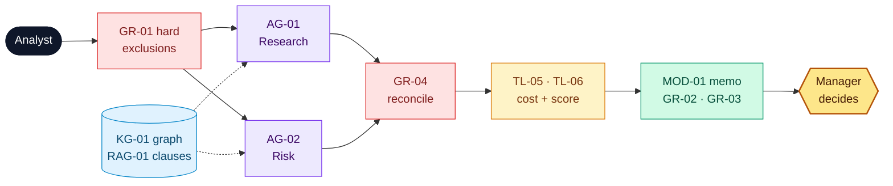

# Northstar Procurement Intelligence

**Owner:** Chief Procurement Officer · **Version:** 1.0 · **Date:** 2026-11-04-17-00-00 UTC · Example 3 of 4 (illustrative numbers)

## 1. Problem

> **Procurement analysts** struggle to **compare suppliers on a like-for-like, compliant basis** because **quotes, contracts, certificates and ownership links sit in separate sources**, resulting in **≈ 20 h per request, 11 % cost-comparison errors and 7 % of awards later flagged for compliance or related-party issues**.

**Scope:** shortlist and recommendation for direct materials. **Non-goals:** issuing POs, payments, supplier contact, legal sign-off.

## 2. Solution: agents find evidence, the graph shows relationships, code scores, the manager decides

| Component | Used for | Catalog ID |
| --- | --- | --- |
| Knowledge graph + clause index + records | Ownership and certificates with provenance; contract evidence; quotes and FX | KG-01, RAG-01, REPO-01 |
| Tools | Discover, traverse, quote, clauses, landed cost, score, approval item | TL-01…07 |
| Models | Agents and memo (GenAI); delivery-reliability forecast (task-specific) | MOD-01, MOD-02 |
| Workflow / agents | Fixed review order; two independent read-only agents | WF-01, WF-02, AG-01, AG-02 |

| # | Use case | Target user | Priority |
| --- | --- | --- | --- |
| UC1 | Recommend a supplier shortlist | Analyst → manager | ★ riskiest |
| UC2 | Compare quotations like for like | Analyst | High |
| UC3 | Related-party and compliance check | Compliance reviewer | High |
| UC4 | Incomplete or conflicting evidence | Analyst | Medium |

## 3. Risks and guards

| Risk | Guard |
| --- | --- |
| Cheapest but ineligible supplier recommended | `GR-01` hard exclusions run before scoring and override any score |
| Numbers invented in the memo | `GR-03`: every number must equal `TL-05` / `TL-06` output |
| Agents agree on a wrong conclusion | Independent evidence; `GR-04` turns any conflict into "needs review" |

**Key assumption:** graph facts (ownership, certificates) are correct and current. Provenance and a 90-day staleness flag on every edge.

## 4. Evals

| Measure | Metric | Baseline → target / threshold |
| --- | --- | --- |
| Value | Analyst time per request · flagged awards | 20 → ≤ 6 h · 7 → < 1 % |
| Quality | Shortlist accuracy · numbers = oracle · conflicts caught | ≥ 90 % (exclusions 100 %) · 100 % · 5/5 |
| Adoption | Recommendations approved without rework | ≥ 75 % |

**Evidence so far:** on 30 gold requests, 8/8 ineligible traps were excluded, 5/5 shared parents were found (text-only: 1/5) and there were 0 numeric mismatches. Time saved is still a hypothesis.
**Decision asked:** the **CPO** approves an **8-week pilot** (2 categories, ≈ €35k) and names a graph data owner by **2026-12-11-17-00-00 UTC**.
