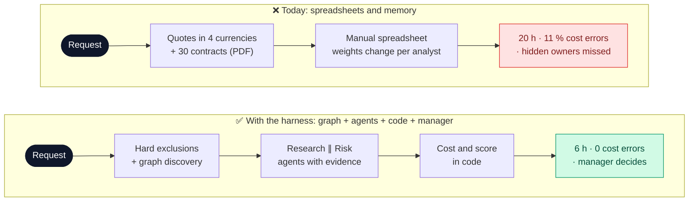
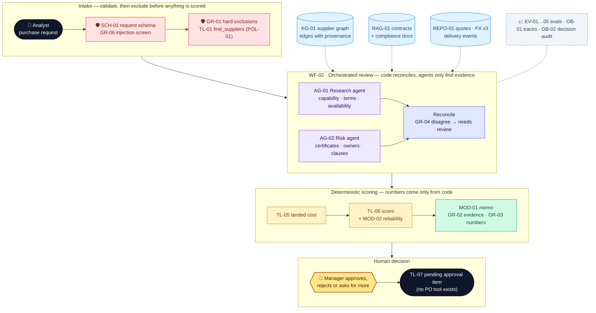
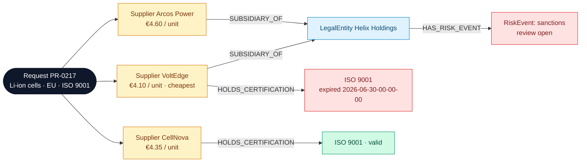

# Northstar Procurement Intelligence — Project deck

**Owner:** Chief Procurement Officer (business) · Procurement Analytics lead (technical) · **Version:** 1.0 · **Date:** 2026-11-04-17-00-00 UTC\
**Example 3 of 4** · Northstar Electronics (fictional company) · Builds on Examples 1–2 (retrieval, tools, state) · All numbers are illustrative.

> **In one line:** two specialist agents research suppliers and check their risk, a **knowledge graph** reveals hidden ownership, **code** computes costs and scores, and a **manager** decides. The system recommends; it never buys.

## 1. Problem

> **Procurement analysts** struggle to **compare suppliers on a like-for-like, compliant basis** because **quotes, contracts, certifications and ownership links sit in separate sources with different formats and currencies**, resulting in **≈ 20 h of analysis per request, 11 % of comparisons with cost errors and 7 % of awards later flagged for compliance or related-party issues**.

| Baseline (today) | Value | Source |
| --- | --- | --- |
| Sourcing requests | ≈ 50 a month (€48M annual spend) | ERP, 12 months |
| Analyst time per request | ≈ 20 h | Time study, n = 25 |
| Comparisons with cost-normalisation errors | 11 % | Internal audit |
| Awards later flagged (expired certificate, shared parent) | 7 % | Compliance review, 12 months |
| Cost | ≈ €50k a month in analyst time + exposure on flagged awards | Derived |

**Scope:** supplier shortlisting and recommendation for direct materials (components for NX-100…NX-Hub).
**Non-goals:** issuing purchase orders, payments, contacting suppliers, legal sign-off by the model.

### Which AI approach, per task

| Option | Fits when | Used for / rejected because |
| --- | --- | --- |
| Rules / process change | Stable, explicit task | **Used:** mandatory exclusions, FX conversion, landed cost, weighted scoring (`TL-05`, `TL-06`). Numbers must be exact and auditable |
| Task-specific model | Clear labels or history | **Used:** delivery-reliability model (`MOD-02`) trained on 150 delivery events per supplier |
| GenAI: workflow | Language and synthesis | **Used:** read contract clauses and compliance statements; write the decision memo |
| GenAI: agent | Next step depends on findings | **Used:** `AG-01` research and `AG-02` risk. Which edge or clause to check next depends on what each finds |
| *Rejected:* "ask an LLM to rank suppliers" | — | Measured baseline `XP-01`: it picked the cheapest **ineligible** supplier in 6 of 8 traps |

## 2. Solution and target users

> We believe that using **a knowledge graph with provenance, two evidence-bound specialist agents and deterministic scoring** to help **procurement analysts and managers** produce **supplier recommendations** will cut **analysis time from 20 h to 6 h and flagged awards from 7 % to < 1 %**, while controlling **invented facts, numeric errors and overconfident consensus** through **hard exclusions before scoring, numbers only from code, evidence IDs on every claim, and escalation when the agents disagree**.

| Success metric | Baseline | Target | How measured |
| --- | --- | --- | --- |
| Analyst time per request (value) | 20 h | ≤ 6 h | Pilot time log, n = 20 |
| Awards later flagged (risk) | 7 % | < 1 % | Compliance review at 6 months |
| Cost-normalisation errors (quality) | 11 % | 0 | `EV-01` vs. oracle |
| Correct shortlist inclusion / exclusion (quality) | — | ≥ 90 % (hard exclusions 100 %) | `EV-05` on 30 gold requests |
| Recommendations approved without rework (adoption) | — | ≥ 75 % | `OB-02` |
| Running cost | €50k a month | ≈ €1.20 a request (two agents) → < €100 a month + €900 hosting | `OB-01` |

**Scale check:** at 5,000 requests a month the cost is ≈ €6k a month. Graph queries and scoring are cheap; agent tokens dominate, so `XP-03` tests whether one agent is enough.

**Target users**

| User | Needs | Pain today |
| --- | --- | --- |
| Procurement analyst | A defensible shortlist, fast | Re-keying quotes; reading 30 contracts |
| Risk and compliance reviewer | Certifications, ownership and restrictive clauses surfaced | Finds issues after the award |
| Procurement manager | Weights, exclusions and evidence in one view | Has to trust the spreadsheet |

## 3. Big picture

*Colour key:* 🟩 model · 🟦 context · 🟨 tool · 🟪 agent / workflow · 🟥 guardrail · 🟧 human decision · ⬜ evals and observability.

### Why a knowledge graph: the trap it catches

The cheapest supplier is **excluded** (expired certificate, a hard rule). Arcos Power shares a parent under sanctions review, so it is **needs review**. CellNova is recommended. Text search alone does not see the shared parent; a 2-hop graph traversal (`TL-02`) does.

### GenAI building blocks at a glance

| Block | What | Why | Objective |
| --- | --- | --- | --- |
| **M** Models | `MOD-01` LLM powers both agents and the memo; task-specific `MOD-02` delivery-reliability model; `MOD-03` judge | Reliability is a forecast from history, which suits a classic ML model; reading clauses needs an LLM | Each model is evaluated on its own task |
| **C** Context | `KG-01` graph (8 entity types, 7 relations, provenance per edge), `RAG-01` clause index, `REPO-01` quotes and FX, `POL-01` exclusions and weights, `MEM-01` decision record | Ownership is a *relationship*, not a sentence; graph facts need source and validity | Every non-numeric claim cites an edge or a clause ID |
| **T** Tools | `TL-01..06` read and compute; `TL-07` creates a *pending approval item* only | Agents must query facts, not recall them | No tool can buy; all tools are typed and scoped |
| **W** Workflow | `WF-01` source and compare; `WF-02` orchestrate, reconcile, approve | The order of steps (exclude → research → score → approve) is policy | Exclusions always run before scoring |
| **A** Agents | `AG-01` research, `AG-02` risk; independent, read-only, call budget 10 | Two roles with separate evidence reduce shared blind spots | Agents return findings in `SCH-02`, never scores |
| **G** Guardrails | `GR-01` hard exclusions, `GR-02` evidence required, `GR-03` numbers from code, `GR-04` disagreement escalation, `GR-05` agent scope, `GR-06` injection screen on supplier docs, `GR-07` approval gate | Suppliers write their own documents, so some are adversarial | Hard rules hold 100 % of the time |
| **E** Evals | `EV-01` deterministic, `EV-02` graph and retrieval, `EV-03` agents, `EV-04` memo judge, `EV-05` shortlist | Separate fact, number, reasoning and writing failures | All gates pass on the 30 gold requests |
| **X** Experiments | `XP-01` naive LLM vs. harness, `XP-02` graph vs. text-only, `XP-03` two agents vs. one | Prove that each complex part earns its cost | Keep the graph and the second agent only if they win |
| **O** Observability | `OB-01` per-agent traces, `OB-02` decision audit (weights, versions, approver) | A procurement decision must be defensible months later | Any award can be replayed with the same rule version |

## 4. Use cases

| # | Use case | Target user | Trigger | Expected output | Priority |
| --- | --- | --- | --- | --- | --- |
| UC1 | Recommend a supplier shortlist | Analyst → manager | A new purchase request (PR-0217) | Ranked shortlist + exclusions + evidence memo → approval item | ★ riskiest |
| UC2 | Compare quotations like for like | Analyst | 3–6 quotes in different currencies and terms | Normalised landed-cost grid with FX source and version | High |
| UC3 | Related-party and compliance check | Compliance reviewer | A supplier enters a shortlist | Ownership paths, certificate status, risk events, with provenance | High |
| UC4 | Handle incomplete or conflicting evidence | Analyst | Missing certificate or a quote that contradicts the contract | "Needs review" with the exact conflict, never an invented attestation | Medium |

Full details: [`use-cases.md`](use-cases.md).

## 5. Risks analysis

| Risk / assumption | Impact if wrong | Guard or validation | Owner |
| --- | --- | --- | --- |
| ★ **Key assumption:** graph facts (ownership, certificates) are correct and current | A related-party or expired supplier is recommended | Provenance + `effective_to` on every edge; facts older than 90 days marked stale; `EV-02` provenance tests | Compliance lead |
| Numeric hallucination | Wrong award on price | `GR-03`: every number in the memo must match `TL-05` or `TL-06` output | Procurement Analytics lead |
| Overconfident consensus | Both agents miss the same issue | Independent prompts and tools; `GR-04` escalates disagreement; `XP-03` | Procurement Analytics lead |
| Criteria gaming / weight tweaking | Biased awards | `GR-01` exclusions before scoring; weight profile versioned; changes need CPO sign-off | CPO |
| Injection in supplier documents | The agent "believes" a planted claim | `GR-06`; supplier text never overrides graph or rule facts | Security officer |
| Automation bias | The manager rubber-stamps | The memo shows sensitivity ("ranking flips if the weight of X changes by ±10 %"); 10 % of approvals audited | CPO |

**Regulation:** GDPR (contact data of supplier staff only); EU AI Act: decision support, not automated decision-making; public-procurement and anti-corruption rules mean every award keeps a human approver and an audit trail.

## 6. Conclusions

| Now: proven (prototype, 30 gold requests) | Still a hypothesis |
| --- | --- |
| Hard exclusions correct on 8/8 "cheap but ineligible" traps | 20 → 6 h on real requests |
| The graph surfaces 5/5 shared-parent traps (text-only: 1/5) | Graph data quality on all 400 suppliers |
| 0 numeric mismatches between the memo and code | Managers use the sensitivity view |

**Next — decision asked:** the **CPO** approves an **8-week pilot** on two categories (cells, displays), ≈ €35k, by **2026-12-11-17-00-00 UTC**, and names a **graph data owner**. V1 scope: UC1–UC3; UC4 hardening follows.

## 7. Component catalog

| ID | Name | Type | Description | Used by |
| --- | --- | --- | --- | --- |
| KG-01 | Supplier knowledge graph | Knowledge graph | `Supplier`, `LegalEntity`, `Product(Category)`, `Certification`, `Region`, `Contract`, `RiskEvent`; edges `OWNED_BY`, `SUBSIDIARY_OF`, `SUPPLIES`, `AUTHORIZED_IN`, `HOLDS_CERTIFICATION`, `PARTY_TO`, `HAS_RISK_EVENT`; provenance `{source_id, observed_at, effective_to, verified_by}` | UC1, UC3, UC4 |
| RAG-01 | Contract and compliance index | RAG index | 30 contracts + 30 compliance statements, clause-level chunks, version metadata (pattern from Example 1) | UC1, UC3, UC4 |
| REPO-01 | Procurement records | Repository | Quotes, requests, delivery events, FX rate table (frozen, versioned) | UC1, UC2 |
| POL-01 | Exclusions and scoring profile | Policy | Hard exclusions + weights (price 40, reliability 25, terms 20, risk 15); versioned | UC1, UC2, UC4 |
| MEM-01 | Decision record | Memory | `{request_id, requirements, candidates, excluded, evidence_ids, findings, score_profile_v, unresolved_risks, decision}` | UC1, UC4 |
| SCH-01 | Purchase-request schema | Schema | Category, quantity, region, deadline, mandatory certificates | UC1 |
| SCH-02 | Agent finding schema | Schema | `{claim, evidence_ids[], confidence, conflict?}`; no score field allowed | UC1, UC3, UC4 |
| PRM-01 | Research-agent prompt | Prompt | Role, tools, "report evidence, never rank" | UC1 |
| PRM-02 | Risk-agent prompt | Prompt | Role, tools, "absence of evidence is a finding" | UC1, UC3 |
| MOD-01 | Agent and memo LLM | Model (GenAI) | Reasoning for `AG-01`/`AG-02`; writes the decision memo | UC1, UC3 |
| MOD-02 | Delivery-reliability model | Model (task-specific) | Gradient-boosted classifier; P(late delivery) per supplier from delivery events | UC1, UC2 |
| MOD-03 | Judge LLM | Model (GenAI) | Scores the memo for defensibility, completeness and uncertainty | UC1 |
| TL-01 | `find_suppliers` | Tool (read) | Category, region, quantity, deadline → candidates + exclusions | UC1 |
| TL-02 | `graph_neighbors` | Tool (read) | Typed traversal, max depth 3, edges with provenance | UC1, UC3 |
| TL-03 | `get_supplier_quote` | Tool (read) | Offer lines, currency, validity, terms | UC1, UC2 |
| TL-04 | `retrieve_contract_clauses` | Tool (read) | Clause citations by contract and topic | UC1, UC3, UC4 |
| TL-05 | `calculate_total_landed_cost` | Tool (compute) | Price + shipping + duty + FX (rate version) → breakdown | UC1, UC2 |
| TL-06 | `score_supplier` | Tool (compute) | Weighted score, exclusions, ±10 % sensitivity | UC1 |
| TL-07 | `submit_recommendation_for_approval` | Tool (act, limited) | Creates a pending approval item; cannot issue a PO | UC1 |
| WF-01 | Source and compare | Workflow | Parse request → exclusions → discover → quotes → cost → score | UC1, UC2 |
| WF-02 | Orchestrated review and approval | Workflow | Parallel agents → reconcile → memo → approval → audit | UC1, UC4 |
| AG-01 | Supplier research agent | Agent | Capability, availability, commercial terms; read-only | UC1, UC4 |
| AG-02 | Risk and compliance agent | Agent | Certificates, ownership paths, risk events, restrictive clauses; read-only | UC1, UC3, UC4 |
| GR-01 | Hard-exclusion gate | Guardrail (execution) | Mandatory rules run before scoring and override any score | UC1, UC2 |
| GR-02 | Evidence required | Guardrail (output) | Every non-numeric claim cites a `KG-01` edge or an `RAG-01` clause | UC1, UC3 |
| GR-03 | Numbers from code only | Guardrail (output) | Every number in the memo must match `TL-05` / `TL-06` output | UC1, UC2 |
| GR-04 | Disagreement escalation | Guardrail (execution) | Conflicting findings → "needs review", never averaged | UC1, UC4 |
| GR-05 | Agent scope and budget | Guardrail (execution) | Read-only tools, 10 calls, depth ≤ 3, 90 s | UC1, UC3 |
| GR-06 | Supplier-document injection screen | Guardrail (input) | Supplier text is data; detector; it cannot overwrite graph facts | UC1, UC3, UC4 |
| GR-07 | Approval gate | Guardrail (execution) | Only a manager identity can approve; no PO tool exists | UC1 |
| EV-01 | Deterministic checks | Eval (code) | Exclusions 100 %, landed cost = oracle, no approval bypass | UC1, UC2 |
| EV-02 | Graph and retrieval | Eval (code) | Expected edges + provenance; clause recall@5 ≥ 85 % | UC3 |
| EV-03 | Agent eval | Eval (code + judge) | Role adherence, evidence coverage, conflict detection | UC1, UC4 |
| EV-04 | Memo judge | Eval (LLM judge) | `MOD-03`, 0–4 on 3 criteria; calibrated on 10 human reviews | UC1 |
| EV-05 | Shortlist accuracy | Eval (code) | Inclusion and exclusion vs. gold, ≥ 90 % | UC1 |
| XP-01 | Naive LLM ranking vs. harness | Experiment | Baseline for the business case | UC1 |
| XP-02 | Graph vs. text-only risk check | Experiment | Shared-parent detection rate | UC3 |
| XP-03 | Two agents vs. one | Experiment | Conflict detection vs. tokens | UC1 |
| OB-01 | Per-agent trace | Observability | Tool calls, evidence IDs, tokens, latency, model and prompt version | UC1, UC3 |
| OB-02 | Decision audit | Observability | Request → exclusions → scores (profile v) → memo → approver | UC1, UC4 |

---

### Pitch (5 slides)

| # | Slide title (states the conclusion) | From |
| --- | --- | --- |
| 1 | "7 % of awards are flagged after signature, at 20 h of analysis each" | §1 |
| 2 | "Agents find evidence, code scores, the manager decides: 6 h per request" | §2, §4 |
| 3 | "The graph catches the shared parent that text search misses" | §3, UC3 |
| 4 | "Graph data quality is the assumption to protect, so it needs an owner" | §5 |
| 5 | "8/8 traps excluded, 0 numeric errors: approve an 8-week pilot" | §2, §6 |
