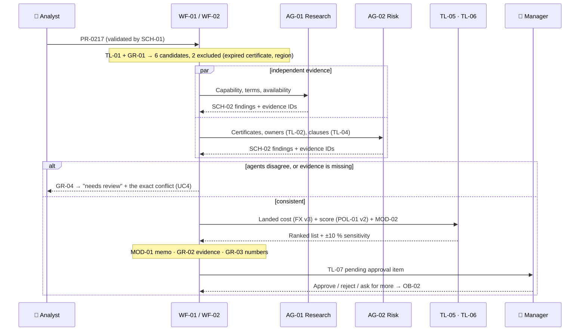

# Northstar Procurement Intelligence — Use cases

**Appendix to the project deck** · Version 1.0 · 2026-11-04-17-00-00 UTC\
Component IDs refer to the catalog (project deck, §7). ★ = riskiest use case, designed and prototyped first.

| # | Use case | Pattern | Autonomy | Priority |
| --- | --- | --- | --- | --- |
| UC1 | Recommend a supplier shortlist | Workflow `WF-01` → `WF-02` with two agents | Recommends; the manager decides | ★ riskiest |
| UC2 | Compare quotations like for like | Workflow `WF-01` (no agent) | Code computes; the analyst reviews | High |
| UC3 | Related-party and compliance check | Agent `AG-02` | Suggests; the reviewer decides | High |
| UC4 | Handle incomplete or conflicting evidence | `WF-02` escalation branch | Acts alone (flags); a human resolves | Medium |

---

## UC1 ★ Recommend a supplier shortlist

### 1. Story

> "As a **procurement analyst**, when **request PR-0217 arrives for 40,000 Li-ion cells for the EU with ISO 9001 required**, I want **an evidence-backed shortlist with exclusions and sensitivity**, so that **my manager can approve a defensible award in one meeting**."

### 2. User flow

| Step | Human | AI | Tool / system | Autonomy |
| --- | --- | --- | --- | --- |
| 1 | Submits the request | — | `SCH-01` validation | — |
| 2 | — | — | `TL-01` + `GR-01` hard exclusions | **Code decides** |
| 3 | — | `AG-01` and `AG-02` gather evidence in parallel | `TL-02`, `TL-03`, `TL-04` | Acts alone (read only) |
| 4 | — | — | Reconcile; `GR-04` on conflict | Code |
| 5 | — | — | `TL-05`, `TL-06`, `MOD-02` | **Code decides the numbers** |
| 6 | Reviews the memo | `MOD-01` writes it (`GR-02`, `GR-03`) | — | Suggests |
| 7 | **Manager approves, rejects or asks for more** | — | `TL-07`, `GR-07`, `OB-02` | Human |

**On failure:** an agent exceeds its budget (`GR-05`) → return partial findings marked incomplete; no candidate survives the exclusions → report "no eligible supplier" with the reasons (never relax a rule); FX table older than 7 days → block scoring.

### 3. Context

| Step | Need | Component | Freshness & access |
| --- | --- | --- | --- |
| 2–3 | Supplier facts and relations | `KG-01` | Edge provenance; > 90 days = stale and flagged |
| 3 | Contract clauses, compliance statements | `RAG-01` | Version-aware (Example 1 pattern) |
| 3–5 | Quotes, FX, delivery history | `REPO-01` | FX table frozen per run (version logged); quotes past validity excluded |
| 2, 5 | Exclusions, weights | `POL-01` | Versioned; changes need CPO sign-off |
| all | Decision record | `MEM-01` | Persisted per stage; immutable after the decision |
| 3, 6 | Output contracts | `SCH-02`, `PRM-01`, `PRM-02` | `SCH-02` rejects any score field from agents |

### 4. Tools

| Tool | Purpose | Read / act |
| --- | --- | --- |
| `TL-01` `find_suppliers` | Candidates + exclusions | Read |
| `TL-02` `graph_neighbors` | Ownership and certificate paths | Read |
| `TL-03` `get_supplier_quote` | Offer lines and terms | Read |
| `TL-04` `retrieve_contract_clauses` | Clause citations | Read |
| `TL-05` / `TL-06` | Landed cost / score + sensitivity | Compute (deterministic) |
| `TL-07` | Pending approval item | Act (limited: no PO, no money) |

Arguments are validated by code (`GR-05`): request ID fixed by the workflow, depth ≤ 3, only allowed relation types.

### 5. Flow and models

**Workflow with two agent steps.** `WF-02` fixes the order *exclude → research ∥ risk → reconcile → score → memo → approve*. Agents are used only where the next lookup depends on what was found (e.g. a parent company → check its risk events).

| AI step | Model | Why |
| --- | --- | --- |
| Research and risk reasoning | `MOD-01` in `AG-01`, `AG-02` | Reads clauses, decides the next evidence to fetch |
| Delivery reliability | `MOD-02` (task-specific) | A forecast from structured history; AUC 0.81 on held-out data |
| Cost, score, ranking | **none: code** | Must be exact, reproducible and auditable |
| Memo | `MOD-01` | Clear, defensible language, bound to evidence IDs |

### 6. Guardrails

| Input | Execution | Output |
| --- | --- | --- |
| `SCH-01` rejects incomplete requests; `GR-06` treats supplier documents as untrusted ("this supplier is fully certified" in a PDF is *not* evidence) | `GR-01` exclusions first; `GR-05` read-only, budget and depth; `GR-04` disagreement → needs review; `GR-07` only a manager approves | `GR-02` claims need edge or clause IDs; `GR-03` numbers must equal tool outputs; uncertainty stated |

### 7. Evals

Test set: 30 gold requests: 7 normal, 8 "cheap but ineligible", 5 shared-parent traps, 5 expired certificates, 5 contract conflicts.

| Dimension | Metric | Evaluator | Threshold |
| --- | --- | --- | --- |
| Correctness | Shortlist inclusion / exclusion | `EV-05` code | ≥ 90 % (hard exclusions 100 %) |
| Numbers | Landed cost and score vs. oracle | `EV-01` code | 100 % |
| Agents | Evidence coverage; conflict detected | `EV-03` | ≥ 90 %; 5/5 conflicts |
| Memo | Defensibility, completeness, uncertainty | `EV-04` judge (`MOD-03`) | ≥ 3 / 4 |
| Safety | Approval bypass | `EV-01` | 0 |

### 8. Observability

| Signal | What is logged | Alert / review trigger |
| --- | --- | --- |
| Traces | Per agent: tool calls, evidence IDs, tokens; prompt and model version (`OB-01`) | Agent hits its budget; stale edge used |
| Speed, errors, cost | Run time, € per request | > 10 min or > €3 per request |
| Decision quality | Approver, decision, weight-profile version, sensitivity flips (`OB-02`) | Manager overrides the top rank > 30 % of the time |

### 9. Experiments

| Hypothesis | Variant vs. baseline | Dataset | Decision metric |
| --- | --- | --- | --- |
| The harness beats a naive LLM ranking | `XP-01` LLM ranks raw quotes vs. harness | 30 gold requests | Correct exclusions: 2/8 vs. 8/8 |
| Two agents catch more than one | `XP-03` one combined agent vs. `AG-01` + `AG-02` | 10 conflict cases | Conflicts detected at ≤ 1.5× tokens |

### 10. Risks and open questions

- Both agents use the same LLM, so their blind spots may correlate → `XP-03`; consider a different model for `AG-02`.
- Weight profiles can be gamed → versioned, CPO sign-off, sensitivity shown in every memo.
- Who maintains `KG-01` ownership data after the pilot? (Decision asked of the CPO.)

---

## UC2 Compare quotations like for like

**1. Story:** "As a **procurement analyst**, when **I receive 5 quotes in EUR, USD and CNY with different Incoterms**, I want **one landed-cost grid**, so that **I compare the true cost, not the headline price**."

**2. User flow**

| Step | Human | AI | Tool / system | Autonomy |
| --- | --- | --- | --- | --- |
| 1 | Selects the request | — | `TL-03` loads the quotes from `REPO-01` | Code |
| 2 | — | — | `TL-05`: price + freight + duty + FX (v3) | **Code** |
| 3 | — | `MOD-02` adds the late-delivery probability | — | Suggests |
| 4 | **Reviews the grid; checks flagged lines** | — | `GR-01` marks expired quotes | Human |

**3. Context:** `REPO-01` quotes + frozen FX table; `POL-01` for exclusions. **4. Tools:** `TL-03` (read), `TL-05` (compute).

**5. Flow:** `WF-01`, no LLM in the numbers. Using GenAI for arithmetic would be the wrong tool.

**6. Guardrails:** `GR-01` expired quotes are excluded; `GR-03` applies if a memo is later written.

**7. Evals:** `EV-01` landed cost = oracle on 80 quotes (100 %). **8. Observability:** FX version and quote validity per run.

**9. Experiments:** none: deterministic, so unit tests are enough.

**10. Risks:** missing freight terms → line flagged "incomplete", never assumed to be zero.

---

## UC3 Related-party and compliance check

**1. Story:** "As a **compliance reviewer**, when **a supplier enters a shortlist**, I want **its ownership chain, certificate status and risk events, with sources**, so that **I catch related-party and expiry issues before the award, not after**."

**2. User flow**

| Step | Human | AI | Tool / system | Autonomy |
| --- | --- | --- | --- | --- |
| 1 | Opens the supplier | `AG-02` plans: owners → their risk events → certificates → clauses | `GR-05` | Acts alone (read) |
| 2 | — | — | `TL-02` up to 3 hops; `TL-04` restrictive clauses | Read |
| 3 | — | `MOD-01` summarises the findings (`SCH-02`, `GR-02`) | — | Suggests |
| 4 | **Reviewer accepts, rejects or requests verification** | — | Graph view highlights the path | Human |

**3. Context:** `KG-01` (edges with provenance), `RAG-01` compliance statements, `PRM-02`. **4. Tools:** `TL-02`, `TL-04` (read).

**5. Flow:** agent `AG-02`: the path depends on what each hop reveals.

**6. Guardrails:** `GR-02` every claim cites an edge or a clause; `GR-06` on supplier statements; stale edges are shown as "unverified".

**7. Evals:** `EV-02` expected edges and provenance on 5 shared-parent + 5 expired-certificate traps (10/10); clause recall@5 ≥ 85 %.

**8. Observability:** `OB-01` traversal paths and the edges used.

**9. Experiments:** `XP-02` graph vs. text-only; prototype result 5/5 vs. 1/5 shared parents found.

**10. Risks:** ownership data from one registry only → add a second source; flag single-source edges.

---

## UC4 Handle incomplete or conflicting evidence

**1. Story:** "As a **procurement analyst**, when **a quote says 30-day payment terms but the contract says 60**, or **a certificate is missing**, I want **the system to stop and show me the exact conflict**, so that **nobody approves on an invented or averaged fact**."

**2. User flow**

| Step | Human | AI | Tool / system | Autonomy |
| --- | --- | --- | --- | --- |
| 1 | — | `AG-01` / `AG-02` report findings with `conflict` set (`SCH-02`) | `TL-04` clause, `KG-01` edge | Acts alone (flag) |
| 2 | — | — | `GR-04` → status "needs review" in `MEM-01` | Code |
| 3 | **Analyst resolves: asks the supplier, picks the source, or excludes** | — | `OB-02` logs the resolution | Human |

**3. Context:** `MEM-01` `unresolved_risks`; both sources linked (`RAG-01` clause, `KG-01` edge). **4. Tools:** `TL-04` (read).

**5. Flow:** the `WF-02` escalation branch. It is deterministic once a conflict is flagged.

**6. Guardrails:** `GR-04` never averages or picks a side; `GR-06` supplier claims cannot resolve their own conflict; a missing certificate = ineligible, never assumed (a rule in `POL-01`).

**7. Evals:** `EV-03` 5 contract conflicts + 5 missing certificates → all 10 flagged, 0 invented attestations.

**8. Observability:** count of conflicts per supplier, to find unreliable suppliers.

**9. Experiments:** none for V1. The rule is binary (flag or not); tune it only if false alarms exceed 20 %.

**10. Risks:** too many flags slow the process → measure the flag rate in the pilot; allow the manager to accept a documented exception.
