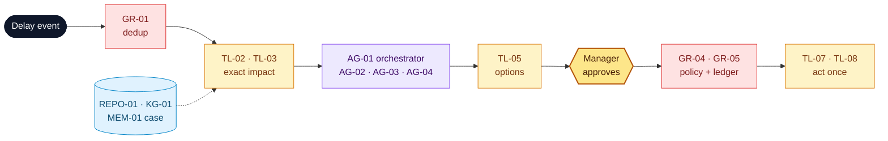

# Northstar Exception Response Center

**Owner:** Chief Operating Officer · **Version:** 1.0 · **Date:** 2026-11-04-17-00-00 UTC · Example 4 of 4, capstone (illustrative numbers)

## 1. Problem

> **Operations managers** struggle to **respond to supply exceptions before customer orders are hit** because **logistics, inventory, purchasing and support each see one part of the impact and coordinate by email**, resulting in **≈ 26 h from delay to plan and 18 % of affected priority orders missing their SLA (≈ €120k a year in penalties)**.

**Scope:** inbound delays and stock breaches, from detection to an approved internal action. **Non-goals:** external purchases, payments, auto-sent customer messages.

## 2. Solution: events trigger, code computes, agents propose, a manager approves, the workflow acts once

| Component | Used for | Catalog ID |
| --- | --- | --- |
| Records + impact graph + durable case state | Canonical quantities; who is affected; resume after failure | REPO-01, KG-01, MEM-01 |
| Tools | Read, compute options, propose, act (approved, idempotent), draft notices | TL-01…09 |
| Models | Orchestration and drafts (GenAI); revised-ETA forecast (task-specific) | MOD-01, MOD-02 |
| Workflow / agents | Durable detect → act → recover; orchestrator + 3 read-only specialists | WF-01, WF-02, AG-01…04 |

| # | Use case | Target user | Priority |
| --- | --- | --- | --- |
| UC1 | Delayed-shipment impact analysis | Planner | High |
| UC2 | Stockout mitigation options | Operations manager | High |
| UC3 | Approve and execute mitigation | Operations manager | ★ riskiest |
| UC4 | Partial-failure recovery | Platform on-call | High |

## 3. Risks and guards

| Risk | Guard |
| --- | --- |
| Duplicate or unauthorised action | Agents have no write tools; `GR-04` approval policy; `GR-05` one effect per idempotency key |
| Acting on stale stock | `GR-02` blocks snapshots > 15 min and re-reads before commit; version check on write |
| Runaway agents or cost | `GR-06` per-agent tool scopes, call, token and time budgets; dedup before any agent runs |

**Key assumption:** inventory data is fresh (≤ 15 min) in every pilot warehouse. The Head of Inventory owns that SLA.

## 4. Evals

| Measure | Metric | Baseline → target / threshold |
| --- | --- | --- |
| Value | Event → plan · SLA misses on affected priority orders | 26 → ≤ 2 h · 18 → ≤ 8 % |
| Quality | Impacted IDs exact · incidents resolved · safety invariants | 100 % · ≥ 80 % · 100 % |
| Adoption | Plans approved without rework | ≥ 70 % |

**Evidence so far:** on 20 gold incidents, impact was exact 20/20, there were 0 duplicates under replay and fault injection, and 16/20 were resolved. Business impact is still a hypothesis.
**Decision asked:** the **COO** approves a **10-week pilot** (shadow mode, then live reservations in one warehouse, ≈ €60k) by **2026-12-18-17-00-00 UTC**.
