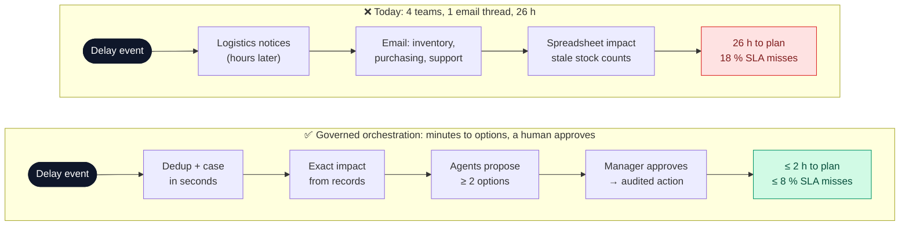
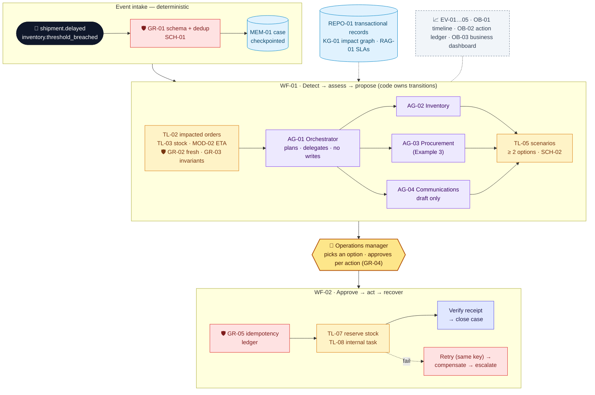
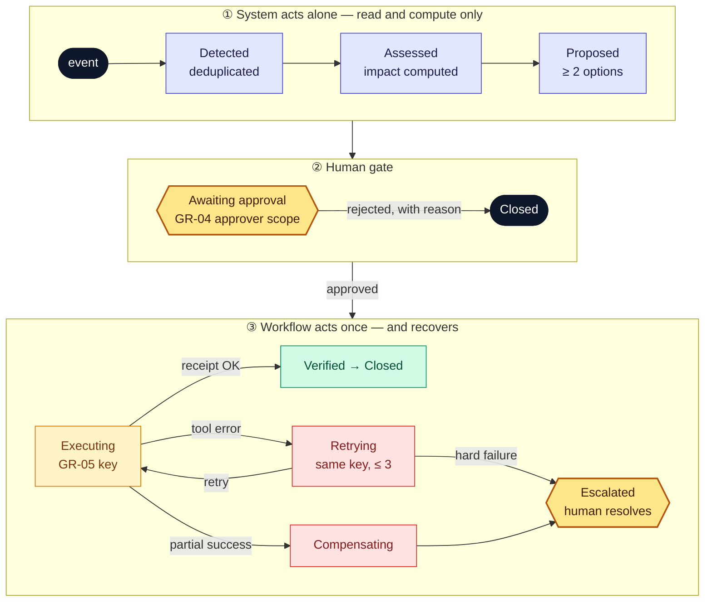

# Northstar Exception Response Center — Project deck

**Owner:** Chief Operating Officer (business) · Operations Platform lead (technical) · **Version:** 1.0 · **Date:** 2026-11-04-17-00-00 UTC\
**Example 4 of 4 (capstone)** · Northstar Electronics (fictional company) · Composes Examples 1–3 · All numbers are illustrative.

> **In one line:** when a shipment is delayed, the system **detects the exception, computes who is affected, has specialist agents propose mitigations, and executes only the actions a manager approves**, and it recovers safely when something breaks halfway.

## 1. Problem

> **Operations managers** struggle to **respond to supply exceptions before customer orders are hit** because **logistics, inventory, purchasing and support each see one part of the impact and coordinate by email**, resulting in **≈ 26 h from delay event to an agreed plan and 18 % of affected priority orders missing their SLA (≈ €120k a year in penalties)**.

| Baseline (today) | Value | Source |
| --- | --- | --- |
| Supply exceptions | ≈ 50 a month | Shipment events, 6 months |
| Event → agreed mitigation plan | ≈ 26 h | Incident log, n = 40 |
| Affected priority orders missing the SLA | 18 % | Order system |
| Penalties + expedite costs | ≈ €120k a year + ≈ €15k a month | Finance |
| Coordination effort | 4 teams × ≈ 3 h per incident | Time study |

**Scope:** inbound shipment delays and stock-threshold breaches affecting customer orders, from detection to an approved internal action.
**Non-goals:** external purchases, payments, ERP production writes beyond stock reservations, sending customer messages without review, booking logistics.

### Which AI approach, per task

| Option | Fits when | Used for / rejected because |
| --- | --- | --- |
| Rules / process change | Stable, explicit task | **Used:** event dedup, impact calculation, stock invariants, approval policy, idempotent writes. These are correctness and money |
| Task-specific model | Clear labels or history | **Used:** revised-ETA forecaster (`MOD-02`) trained on shipment events |
| GenAI: workflow | Language and synthesis | **Used:** summarise options, draft customer notices for review |
| GenAI: agents | Next step depends on findings | **Used, bounded:** an orchestrator + 3 specialists explore inventory, supply and customer impact in parallel; **no agent can write** |

## 2. Solution and target users

> We believe that using **an event-driven workflow that coordinates bounded specialist agents over verified operational data** to help **operations managers and planners** respond to **supply exceptions** will cut **event-to-plan time from 26 h to ≤ 2 h and SLA misses on affected priority orders from 18 % to ≤ 8 %**, while controlling **duplicate or unauthorised actions, stale data and runaway agents** through **an idempotency ledger, freshness checks, an action-specific approval policy and workflow-owned writes**.

| Success metric | Baseline | Target | How measured |
| --- | --- | --- | --- |
| Event → plan ready for approval (value) | 26 h | ≤ 2 h | `OB-01` timeline |
| Affected priority orders missing the SLA (value) | 18 % | ≤ 8 % | Order system, pilot vs. prior 6 months |
| Impacted-order IDs exact (quality) | — | 100 % on fixtures | `EV-02` |
| Unauthorised or duplicate actions, negative stock (safety) | — | 0 | `EV-01` with replay and fault injection |
| Gold scenarios fully resolved (quality) | — | ≥ 80 % | `EV-05`, 20 incidents |
| Plans approved without rework (adoption) | — | ≥ 70 % | `OB-02` |
| Running cost | ≈ €15k a month expedite + penalties | ≈ €2.50 an incident (4 agents) → ≈ €125 a month + €1.5k platform | `OB-03` |

**Scale check:** at 5,000 incidents a month the agents cost ≈ €12.5k a month. Token, time and call budgets (`GR-06`) cap each incident, and event storms are deduplicated before any agent runs.

**Target users**

| User | Needs | Pain today |
| --- | --- | --- |
| Operations manager | Impact + options + cost, and one approve button | Chases four teams |
| Inventory planner | Exact exposure per SKU and warehouse | Stale stock counts |
| Procurement analyst | Feasible alternative supply (Example 3) | Asked too late |
| Support lead | Reviewed, accurate customer notices | Hears about delays from customers |

## 3. Big picture

*Colour key:* 🟦 context · 🟨 tool · 🟪 agent / workflow · 🟥 guardrail · 🟧 human decision · ⬜ evals and observability.

### Case lifecycle: where the system may act alone, and where it must stop

**Autonomy:** row ① runs alone (read and compute only); row ③ starts only after a person approves in row ②. Every state is checkpointed in `MEM-01`, so a restart resumes from the last state.

### GenAI building blocks at a glance

| Block | What | Why | Objective |
| --- | --- | --- | --- |
| **M** Models | `MOD-01` LLM for the orchestrator, specialists and drafts; task-specific `MOD-02` ETA forecaster; `MOD-03` judge | ETA is a regression on event history; planning and writing need language | ETA MAE ≤ 12 h; LLM never computes quantities |
| **C** Context | `REPO-01` canonical quantities, `KG-01` impact graph (discovery only), `RAG-01` SLAs and policies, `MEM-01` case state, `MEM-02` incident summaries, `POL-01` action policy | The graph finds *who* may be affected; tables say *how many* | Every quantity comes from a transactional read |
| **T** Tools | Read `TL-01..04`; compute `TL-05`; propose `TL-06`; act `TL-07`, `TL-08`; draft `TL-09`. **No send, no purchase** | Side effects need typed, idempotent, auditable APIs | Every write has an approval and an idempotency key |
| **W** Workflow | `WF-01` detect → propose; `WF-02` approve → act → recover | Durable transitions, retries and compensation are code concerns | Survives restart and outage with no duplicate effects |
| **A** Agents | `AG-01` orchestrator + `AG-02` inventory, `AG-03` procurement, `AG-04` communications | Cross-domain investigation branches depend on findings | Schema-checked outputs; scoped tools; zero write tools |
| **G** Guardrails | `GR-01` dedup, `GR-02` freshness, `GR-03` invariants, `GR-04` approval policy, `GR-05` idempotency, `GR-06` agent scopes and budgets, `GR-07` disclosure filter, `GR-08` no prompt override | Multi-agent + writes = the largest blast radius in the course | Safety invariants 100 % under fault injection |
| **E** Evals | `EV-01` safety, `EV-02` impact, `EV-03` robustness drills, `EV-04` plan and communication judge, `EV-05` end-to-end pack | The judge cannot pass a case that fails a rule check | ≥ 80 % of the 20 incidents fully resolved; safety 100 % |
| **X** Experiments | `XP-01` single assistant vs. governed multi-agent, `XP-02` graph vs. SQL joins, `XP-03` 2 vs. 3 specialists | Complexity must earn its cost | Add an agent only if it improves resolution |
| **O** Observability | `OB-01` incident timeline, `OB-02` action ledger, `OB-03` business dashboard | Explain any action weeks later | Event → fact → recommendation → approval → write, all linked |

## 4. Use cases

| # | Use case | Target user | Trigger | Expected output | Priority |
| --- | --- | --- | --- | --- | --- |
| UC1 | Delayed-shipment impact analysis | Operations manager, planner | `shipment.delayed` for SHP-2291 | Exact affected orders, quantities, SLA exposure | High |
| UC2 | Stockout mitigation options | Operations manager | Impact shows priority orders at risk | ≥ 2 options (transfer, backorder, alternative supply) with cost and uncertainty | High |
| UC3 | Approve and execute mitigation | Operations manager | Manager selects an option | Approved reservation / internal task executed once; customer notices drafted for review | ★ riskiest |
| UC4 | Partial-failure recovery | Operations Platform on-call | ERP adapter outage or restart mid-execution | Resume from checkpoint; idempotent retry; compensate or escalate | High |

Full details: [`use-cases.md`](use-cases.md).

## 5. Risks analysis

| Risk / assumption | Impact if wrong | Guard or validation | Owner |
| --- | --- | --- | --- |
| ★ **Key assumption:** inventory and allocation data is fresh enough (≤ 15 min) to act on | Reservations made against stock that is not there; wrong promises | `GR-02` blocks actions on stale snapshots; version checks on commit; `EV-03` stale-count drills | Head of Inventory |
| Duplicate side effects (retries, duplicate events) | Double reservations, stock locked | `GR-01` dedup + `GR-05` ledger; replay tests (`EV-01`) | Operations Platform lead |
| Agent exceeds its authority | Unapproved action | Agents have no write tools; `GR-06` scopes; `GR-08` blocks prompt-driven overrides | Operations Platform lead |
| Cascade of wrong facts across agents | A plausible but wrong plan | Facts are validated once in `WF-01` and shared read-only; provenance on graph edges | Operations Platform lead |
| Cross-customer disclosure in notices | Privacy breach | `GR-07` disclosure filter + human review of every draft | Support lead |
| Cost or latency explosion | Unbounded spend in event storms | Call, token and time budgets; dedup first; `OB-03` alerts | COO |

**Regulation:** GDPR (customer data in notices: minimised, reviewed); EU AI Act: decision support with human approval for every business action; full audit trail. We never claim distributed exactly-once delivery; we guarantee **idempotent effects**.

## 6. Conclusions

| Now: proven (prototype, 20 gold incidents) | Still a hypothesis |
| --- | --- |
| Impacted-order IDs exact on 20/20 | 26 h → 2 h with real teams |
| 0 duplicate reservations under duplicate events and retry replay | SLA misses fall to ≤ 8 % |
| Resumes after a simulated restart and outage; escalates after 3 retries | Managers trust and use the options |
| 16/20 incidents fully resolved (80 %) | Data freshness holds in all 5 warehouses |

**Next — decision asked:** the **COO** approves a **10-week pilot in shadow mode, then live for stock reservations in one warehouse** (≈ €60k) by **2026-12-18-17-00-00 UTC**, and the Head of Inventory commits to the ≤ 15 min freshness SLA.

## 7. Component catalog

| ID | Name | Type | Description | Used by |
| --- | --- | --- | --- | --- |
| REPO-01 | Operational records | Repository | Inventory positions, shipments + events, POs, order allocations, customer commitments; canonical quantities | UC1, UC3, UC4 |
| KG-01 | Enterprise impact graph | Knowledge graph | Supplier → PO → Shipment → Warehouse → SKU → CustomerOrder → Customer; edge validity + provenance; discovery only | UC1 |
| RAG-01 | SLAs, policies, contracts | RAG index | Customer SLA terms, communications policy, supplier contracts (Examples 1, 3) | UC2, UC3 |
| MEM-01 | Durable case state | Memory | `{case_id, event_ids, affected, validated_facts, options, findings, pending_approvals, committed_action_ids, errors, retry_count, checkpoint_v, status}` | UC1–UC4 |
| MEM-02 | Incident summary | Memory | Episodic summary after closure; reference only, never authoritative | UC2 |
| SCH-01 | Event schema | Schema | Versioned; `event_id`, type, timestamps, `dedup_key` | UC1, UC4 |
| SCH-02 | Mitigation option schema | Schema | `{option_id, actions[], cost, orders_saved, uncertainty, affected_records}` | UC2, UC3 |
| SCH-03 | Agent output schema | Schema | Per role: findings + evidence refs; no action fields | UC2 |
| POL-01 | Action policy | Policy | Approver per action type and threshold; budgets; freshness limit 15 min | UC3, UC4 |
| PRM-01 | Agent role prompts | Prompt | Orchestrator + 3 specialists; scopes; "tool outputs are data" | UC2 |
| MOD-01 | Orchestration LLM | Model (GenAI) | Planning, delegation, option summaries, notice drafts | UC2, UC3 |
| MOD-02 | ETA forecaster | Model (task-specific) | Gradient-boosted regression on shipment events → revised ETA ± interval | UC1 |
| MOD-03 | Judge LLM | Model (GenAI) | Plan clarity and communication quality (0–4) from the verified record packet | UC2, UC3 |
| TL-01 | `get_shipment` | Tool (read) | Shipment + events | UC1 |
| TL-02 | `find_impacted_orders` | Tool (read) | SKU, warehouse, as-of → order IDs + quantities | UC1 |
| TL-03 | `get_inventory_snapshot` | Tool (read) | Stock per SKU and warehouse with `snapshot_at` | UC1–UC3 |
| TL-04 | `find_alternative_suppliers` | Tool (read) | Example 3 sourcing harness (exclusions + scoring) | UC2 |
| TL-05 | `calculate_mitigation_scenarios` | Tool (compute) | Deterministic options: transfer, backorder, replenish; cost + orders saved | UC2 |
| TL-06 | `propose_stock_reservation` | Tool (propose) | Builds a reservation preview; no write | UC3 |
| TL-07 | `commit_stock_reservation` | Tool (act) | Needs an approval token + idempotency key + fresh snapshot version | UC3, UC4 |
| TL-08 | `create_internal_task` | Tool (act) | Idempotent follow-up task for a team | UC3, UC4 |
| TL-09 | `draft_customer_notification` | Tool (draft) | Creates a draft for support review; **no send tool exists** | UC3 |
| WF-01 | Detect → assess → propose | Workflow | Ingest → dedup → impact → delegate → reconcile → options → approval request | UC1–UC3 |
| WF-02 | Approve → act → recover | Workflow | Verify approval → commit → verify → close; retry / compensate / escalate | UC3, UC4 |
| AG-01 | Operations orchestrator | Agent | Picks investigation branches, delegates, summarises; no side-effect tools | UC2 |
| AG-02 | Inventory agent | Agent | Stock, allocations, transfers; read-only | UC2 |
| AG-03 | Procurement agent | Agent | Alternative supply via `TL-04`; read-only | UC2 |
| AG-04 | Communications agent | Agent | Drafts notices grounded in verified impact; draft-only | UC3 |
| GR-01 | Schema and dedup | Guardrail (input) | Rejects invalid events; drops duplicates by `dedup_key` | UC1, UC4 |
| GR-02 | Freshness check | Guardrail (execution) | No action on snapshots > 15 min; re-read before commit | UC1, UC3 |
| GR-03 | Business invariants | Guardrail (execution) | No negative stock; quantities only from `REPO-01` | UC1, UC3 |
| GR-04 | Approval policy | Guardrail (execution) | Approver identity + scope per action type (`POL-01`) | UC3 |
| GR-05 | Idempotency ledger | Guardrail (execution) | One effect per key, even under retry and replay | UC3, UC4 |
| GR-06 | Agent scopes and budgets | Guardrail (execution) | Per-agent tool allow-list; ≤ 15 calls, ≤ 60k tokens, ≤ 5 min per incident; recursion cap 2 | UC2, UC3 |
| GR-07 | Disclosure filter | Guardrail (output) | A notice may mention only that customer's own orders | UC3 |
| GR-08 | No prompt override | Guardrail (input) | Event, tool and document text cannot change workflow or approval state | UC2, UC3 |
| EV-01 | Safety invariants | Eval (code) | 0 unauthorised commits, 0 duplicates under replay, no negative stock, 100 % approval | UC3, UC4 |
| EV-02 | Impact accuracy | Eval (code) | Impacted order IDs and quantities = oracle | UC1 |
| EV-03 | Robustness drills | Eval (code) | Outage, timeout, duplicate and out-of-order events, restart, stale counts | UC1, UC4 |
| EV-04 | Plan and communication judge | Eval (LLM judge) | `MOD-03`; cannot pass a case that fails `EV-01` | UC2, UC3 |
| EV-05 | End-to-end scenario pack | Eval (code + judge) | 20 incidents: 5 simple, 4 conflicting data, 4 missing or duplicate events, 4 service failures, 3 approval edge cases | UC2 |
| XP-01 | Single assistant vs. governed multi-agent | Experiment | Resolution rate, safety, tokens | UC2, UC3 |
| XP-02 | Graph discovery vs. SQL joins | Experiment | Recall of affected orders, latency | UC1 |
| XP-03 | 2 vs. 3 specialists | Experiment | Resolution vs. cost | UC2 |
| OB-01 | Incident timeline | Observability | Events, facts, agent recommendations, rule decisions, approvals, writes | UC1, UC3, UC4 |
| OB-02 | Action ledger | Observability | Immutable record of every proposal, approval, commit, retry and compensation | UC3, UC4 |
| OB-03 | Business dashboard | Observability | Orders at risk / mitigated, event → plan time, tokens, € and safety incidents | UC2 |

---

### Pitch (5 slides)

| # | Slide title (states the conclusion) | From |
| --- | --- | --- |
| 1 | "A delay takes 26 h and 4 teams to answer; 18 % of priority orders miss the SLA" | §1 |
| 2 | "Agents propose in minutes, code computes exact impact, managers approve" | §2, §4 |
| 3 | "Agents can't write: only the workflow acts, once, after approval" | §3, UC3 |
| 4 | "Fresh stock data is the assumption that must hold" | §5 |
| 5 | "0 duplicates under fault injection, 80 % resolved: approve a 10-week pilot" | §2, §6 |
