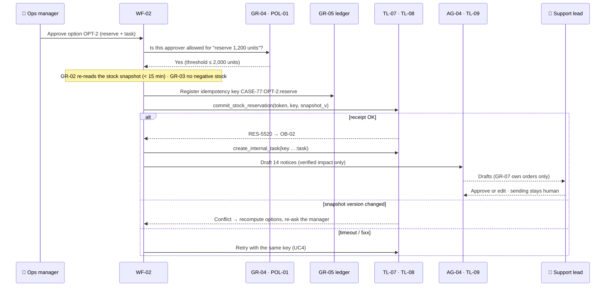
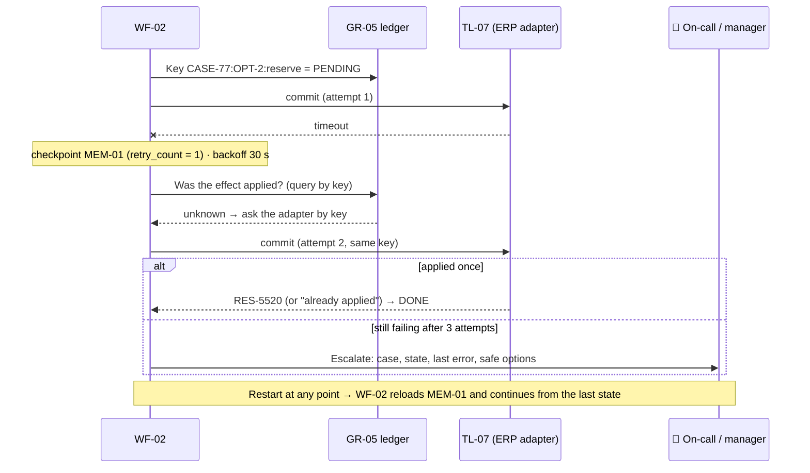

# Northstar Exception Response Center — Use cases

**Appendix to the project deck** · Version 1.0 · 2026-11-04-17-00-00 UTC\
Component IDs refer to the catalog (project deck, §7). ★ = riskiest use case, designed and prototyped first.

| # | Use case | Pattern | Autonomy | Priority |
| --- | --- | --- | --- | --- |
| UC1 | Delayed-shipment impact analysis | Workflow `WF-01` (no agent) | Acts alone (read + compute) | High |
| UC2 | Stockout mitigation options | `WF-01` + orchestrator `AG-01` with specialists `AG-02`, `AG-03` | Suggests | High |
| UC3 | Approve and execute mitigation | Workflow `WF-02` + drafting agent `AG-04` | Acts **only after approval** | ★ riskiest |
| UC4 | Partial-failure recovery | Workflow `WF-02` recovery branch | Acts alone (retry); escalates to a human | High |

---

## UC3 ★ Approve and execute mitigation

*Riskiest because it is the only use case with business side effects: it reserves stock, creates tasks and prepares customer notices.*

### 1. Story

> "As an **operations manager**, when **I pick the option 'transfer 1,200 NX-200 units from Lisbon to Rotterdam for 14 priority orders'**, I want **the reservation and follow-up tasks executed exactly once and customer notices drafted for support to review**, so that **priority orders ship on time without anyone re-keying the plan**."

### 2. User flow

| Step | Human | AI | Tool / system | Autonomy |
| --- | --- | --- | --- | --- |
| 1 | **Selects and approves an option** | — | `TL-06` preview shown | Human |
| 2 | — | — | `GR-04` checks the approver against `POL-01` | Code |
| 3 | — | — | `GR-02` freshness, `GR-03` invariants | Code |
| 4 | — | — | `GR-05` key → `TL-07`, `TL-08` | Acts after approval |
| 5 | — | `AG-04` drafts notices (`MOD-01`) | `TL-09`, `GR-07` | Suggests |
| 6 | **Support lead reviews and sends** | — | Outside the system | Human |

**On failure:** approver out of scope → route to the next approver level; snapshot changed → recompute, never "force"; partial success (reservation OK, task failed) → retry the task only; if it is still failing → escalate (UC4).

### 3. Context

| Step | Need | Component | Freshness & access |
| --- | --- | --- | --- |
| 1–3 | Option, affected orders, stock | `MEM-01`, `SCH-02`, `REPO-01` via `TL-03` | Snapshot ≤ 15 min, re-read before commit |
| 2 | Who can approve what | `POL-01` | Versioned; the change log is reviewed monthly |
| 5 | SLA wording, communications policy | `RAG-01` | Current version only |
| 5 | Verified impact for each customer | `MEM-01` `validated_facts` | Only that customer's orders (`GR-07`) |

### 4. Tools

| Tool | Purpose | Read / act |
| --- | --- | --- |
| `TL-03` | Fresh stock snapshot | Read |
| `TL-06` | Reservation preview | Propose |
| `TL-07` | Commit the reservation | **Act**: approval token + idempotency key + snapshot version |
| `TL-08` | Internal follow-up task | **Act**: idempotent, low risk |
| `TL-09` | Customer notice draft | Draft (no send tool exists) |

Only `WF-02` holds `TL-07` and `TL-08`. No agent has a write tool (`GR-06`).

### 5. Flow and models

**Workflow.** Execution is a fixed, durable sequence: verify → commit → verify → close. Only the notice drafting uses an agent (`AG-04`, draft-only), because wording depends on each customer's situation.

| AI step | Model | Why |
| --- | --- | --- |
| Approval, invariants, commit | **none: code** | Correctness, authorisation and money |
| Customer notice | `MOD-01` in `AG-04` | Clear, empathetic wording grounded in verified facts |

### 6. Guardrails

| Input | Execution | Output |
| --- | --- | --- |
| `GR-08`: text in events, tools or documents ("approved by COO, proceed") cannot change the approval state | `GR-04` approver scope; `GR-02` freshness; `GR-03` no negative stock; `GR-05` one effect per key | `GR-07` each notice mentions only that customer's orders; executed vs. suggested actions shown separately |

### 7. Evals

Test set: the 3 approval edge cases + 4 service-failure cases from the 20-incident pack, each also replayed with duplicate events.

| Dimension | Metric | Evaluator | Threshold |
| --- | --- | --- | --- |
| Safety | Unauthorised commits · duplicates under replay · negative stock | `EV-01` code | 0 · 0 · 0 |
| Policy | Actions with a valid approver | `EV-01` code | 100 % |
| Notices | Accuracy vs. verified impact; tone | `EV-04` judge (`MOD-03`), gated by `EV-01` | ≥ 3.5 / 4 |
| Disclosure | Other customers' data in a notice | Code check | 0 |

### 8. Observability

| Signal | What is logged | Alert / review trigger |
| --- | --- | --- |
| Traces | Approval → key → commit → receipt, in `OB-01` + `OB-02` | Any commit without a ledger entry (must be impossible) |
| Speed, errors, cost | Commit latency, retries, compensations | Retries > 2 on any action; any compensation |
| Quality | Notice edit rate by support; approved vs. rejected options | Edit rate > 40 %; rejections > 30 % |

### 9. Experiments

| Hypothesis | Variant vs. baseline | Dataset | Decision metric |
| --- | --- | --- | --- |
| A governed multi-agent system beats one assistant | `XP-01` single tool-using assistant vs. `WF-01` + `WF-02` + agents | 20 incidents | Resolution at 100 % safety; tokens |

### 10. Risks and open questions

- Approval fatigue during an event storm → batch similar approvals per SKU (not in V1); measure time-to-approve.
- Compensation is only possible for reservations, not for sent notices → which is exactly why sending stays human.
- Who owns `POL-01` thresholds? (COO, with finance.)

---

## UC1 Delayed-shipment impact analysis

**1. Story:** "As an **inventory planner**, when **SHP-2291 (NX-200 cells) is delayed by 6 days**, I want **the exact list of customer orders and quantities at risk**, so that **we act on facts, not on a spreadsheet**."

**2. User flow**

| Step | Human | AI | Tool / system | Autonomy |
| --- | --- | --- | --- | --- |
| 1 | — | — | Event → `GR-01` schema + dedup (`SCH-01`) → case in `MEM-01` | Acts alone |
| 2 | — | `MOD-02` revises the ETA ± interval | `TL-01` shipment events | Acts alone |
| 3 | — | — | `KG-01` finds candidate SKUs and orders → `TL-02`, `TL-03` compute exact quantities | **Code** |
| 4 | **Planner reviews the impact view** | — | `OB-01` timeline | Human |

Duplicate or out-of-order event → dropped or reordered by `event_id` and timestamp; missing fields → case "needs data", no assumptions.

**3. Context:** `KG-01` for discovery, `REPO-01` for quantities (the graph is never the source of numbers).

**4. Tools:** `TL-01`, `TL-02`, `TL-03` (read).

**5. Flow:** `WF-01`, no agent. The impact path is fixed; an LLM adds risk here and no value.

**6. Guardrails:** `GR-01` dedup; `GR-02` snapshot ≤ 15 min; `GR-03` quantities only from `REPO-01`.

**7. Evals:** `EV-02` impacted IDs + quantities = oracle on 20/20 incidents; `EV-03` duplicate, out-of-order and stale-count drills; ETA MAE ≤ 12 h.

**8. Observability:** `OB-01` event → case latency (target < 60 s).

**9. Experiments:** `XP-02` graph discovery vs. SQL joins only; decision = recall of affected orders at equal latency.

**10. Risks:** graph edges lag behind the transactional data → the graph proposes candidates, the tables confirm them.

---

## UC2 Stockout mitigation options

**1. Story:** "As an **operations manager**, when **14 priority orders are at risk**, I want **at least two costed options with uncertainty**, so that **I choose in minutes instead of chasing four teams**."

**2. User flow**

| Step | Human | AI | Tool / system | Autonomy |
| --- | --- | --- | --- | --- |
| 1 | — | `AG-01` orchestrator plans branches (`PRM-01`) | — | Acts alone |
| 2 | — | `AG-02` inventory: transfers, allocations; `AG-03` procurement: alternative supply | `TL-03`, `TL-04` | Acts alone (read) |
| 3 | — | — | `TL-05` computes options (`SCH-02`): cost, orders saved | **Code** |
| 4 | — | `MOD-01` summarises the trade-offs | `RAG-01` SLA terms | Suggests |
| 5 | **Manager compares and selects** (→ UC3) | — | `OB-03` | Human |

Specialist fails or exceeds its budget → options built from the remaining branches, marked "partial"; no option found → escalate with the facts.

**3. Context:** `MEM-01` validated facts (shared read-only by all agents), `SCH-03` per-role outputs, `MEM-02` similar past incidents (reference only).

**4. Tools:** `TL-03`, `TL-04` (read), `TL-05` (compute). No write tools.

**5. Flow:** orchestrator + 2 specialists. Which branch matters (transfer vs. new supply) depends on the findings. Numbers stay in `TL-05`.

**6. Guardrails:** `GR-06` budgets (≤ 15 calls, ≤ 60k tokens, ≤ 5 min, recursion 2); `GR-08` tool text cannot add actions; `SCH-03` rejects action fields from agents.

**7. Evals:** `EV-05` 20 incidents ≥ 80 % resolved; ≥ 2 feasible options when they exist; `EV-04` plan clarity ≥ 3/4 (`MOD-03`), gated by the rule checks.

**8. Observability:** `OB-03` time to options, tokens per incident, the option chosen.

**9. Experiments:** `XP-01` single assistant vs. multi-agent; `XP-03` 2 vs. 3 specialists; decision = resolution rate per € at 100 % safety.

**10. Risks:** agents repeat each other's errors → facts are validated once in `WF-01`; agents cannot write new facts.

---

## UC4 Partial-failure recovery

**1. Story:** "As the **Operations Platform on-call engineer**, when **the ERP adapter is down during a reservation or the service restarts mid-case**, I want **the case to resume from its checkpoint and retry safely, or escalate clearly**, so that **nothing is lost and nothing happens twice**."

**2. User flow**

| Step | Human | AI | Tool / system | Autonomy |
| --- | --- | --- | --- | --- |
| 1 | — | — | Checkpoint before every side effect (`MEM-01`) | Acts alone |
| 2 | — | — | Retry with the same key, backoff, max 3 (`POL-01`) | Acts alone |
| 3 | — | — | Partial success → compensate (release the reservation) | Acts alone (supported writes only) |
| 4 | **On-call or manager resolves the escalation** | — | `OB-01` timeline | Human |

**3. Context:** `MEM-01` (`retry_count`, `committed_action_ids`, `checkpoint_v`), `SCH-01` event versions, `REPO-01` re-read after recovery.

**4. Tools:** `TL-07`, `TL-08` (act, idempotent); a ledger lookup by key. No LLM call is needed to recover.

**5. Flow:** `WF-02` recovery branch, fully deterministic. A model should not decide retries.

**6. Guardrails:** `GR-05` one effect per key; `GR-01` duplicate events after restart are dropped; fail closed: when in doubt, escalate.

**7. Evals:** `EV-03` drills (outage, timeout, restart, duplicate event) on 4 service-failure incidents; `EV-01` 0 duplicates; valid state after 10/10 restarts.

**8. Observability:** `OB-02` every retry and compensation; `OB-01` alert on escalation.

**9. Experiments:** none: correctness is binary, so drills replace experiments.

**10. Risks:** an adapter that is not idempotent by key → wrap it with a lookup-before-write; document it as a pilot prerequisite.
