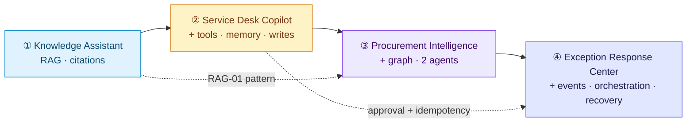

# Worked examples: GenAI system design project

Four model submissions for the project in [`../guidelines/`](../guidelines/guidelines.md), built from the lab PRDs in [`../pre-definition-examples/`](../pre-definition-examples/README.md). Each one follows the templates (project deck, use cases, one-pager) and passes the [checklist](../guidelines/checklist.md).

All four are set in the same fictional company, **Northstar Electronics** (products NX-100…NX-Hub), and each later example reuses components from the earlier ones. All numbers are illustrative.

| # | Example | Problem → solution | GenAI focus | ★ Riskiest use case |
| --- | --- | --- | --- | --- |
| 1 | [Knowledge Assistant](01-knowledge-assistant/) | Stale, conflicting policies → cited answers from current sources | RAG, metadata filters, citations, abstention | Version-aware policy Q&A |
| 2 | [Service Desk Copilot](02-support-copilot/) | Agents juggle 5 systems → the copilot reads, rules decide, the agent approves | Tools, workflow + bounded agent, case memory, protected writes | Warranty eligibility claim |
| 3 | [Procurement Intelligence](03-procurement-assistant/) | Non-comparable quotes, hidden owners → evidence-bound recommendation | Knowledge graph, 2 specialist agents, deterministic scoring | Supplier shortlist recommendation |
| 4 | [Exception Response Center](04-operations-orchestrator/) | 26 h email coordination → governed, event-driven orchestration | Multi-agent orchestration, approvals, idempotency, recovery | Approve and execute mitigation |

## How the examples build on each other

## Files in each example

| File | What it is |
| --- | --- |
| `project-deck.md` | PRD: problem, solution, big picture, use-case list, risks, conclusions, component catalog, pitch outline |
| `use-cases.md` | Appendix: every use case in the 10 template topics; the ★ one in full detail |
| `one-pager.md` | The sponsor's 2-minute summary, ending with the decision asked |
| `pdf/` | The same three documents rendered as PDF (A4) |

## Diagram conventions

The same colour means the same building block in every diagram: 🟩 model · 🟦 context · 🟨 tool · 🟪 agent / workflow · 🟥 guardrail · 🟧 human decision · ⬜ evals and observability.

## Re-rendering the PDFs

The Markdown is the source; the Mermaid diagrams render on GitHub as they are. To rebuild the PDFs: render the Mermaid blocks to SVG with `@mermaid-js/mermaid-cli` (`mmdc -i doc.md -o build/doc.md -e svg`), convert to HTML with `pandoc -f gfm -s`, then print to PDF with headless Chrome (`--print-to-pdf --no-pdf-header-footer`).
