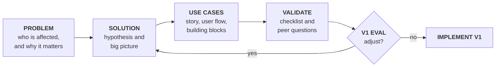

# GenAI System Design Project: guidelines

> **Disclaimer:** these are guidelines, not strict rules. They give a rationale and a structure for learning; adapt them to your problem and explain why.

## Purpose

Design **one AI system that solves a real business problem**, with GenAI as the main focus. Task-specific models (classification, extraction, forecasting) are welcome, alone or combined with GenAI. You do not have to build it; you have to show the business case and the reasoning that makes it trustworthy.

> Which business problem is worth solving with AI, what must exist around the model for it to work reliably, and how will we know it creates value?

The model is the engine. The **harness** (the building blocks around it) decides what the model can see, do and be trusted with.

## Thinking path

## Building blocks (vocabulary)

| | Block | What it does | Examples |
| --- | --- | --- | --- |
| **M** | Models | The AI engines | GenAI model (LLM); task-specific model (classifier, extractor, forecaster) |
| **C** | Context | What the model needs to know | Documents, RAG index, repositories, knowledge graph, schemas, memory, prompts & skills, policies |
| **T** | Tools | What the model can fetch, compute or do | Tool, API, MCP server (a shared connector); read or act |
| **W** | Workflow | Flow where **your code** decides the path | Fixed steps, routing by type, draft then check |
| **A** | Agent | Flow where **the model** decides the path | Think → act → observe loop; single or multi-agent |
| **G** | Guardrails | Checks in code around the model | Input, execution, output |
| **E** | Evals | Tests that prove quality | Code checks, an LLM as judge, human review; accuracy for classifiers |
| **X** | Experiments | Compare design choices | A/B on a fixed dataset, small live pilot |
| **O** | Observability | See what it did, why, how fast, at what cost | Traces, errors, quality signals |

**Flow** patterns, simplest first: prompt → model, workflow, agent.
**Success metrics** measure business value (time, cost, revenue, risk); **evals** measure the system's quality.

## Deliverables

| Deliverable | What it is | Size | Guide |
| --- | --- | --- | --- |
| **Project deck (PRD)** | The full design: what, for whom, why, and how each use case works | 6–10 pages | `template-project-deck.md`, `template-use-cases.md` |
| **Pitch** | The project deck's story for a decision maker | 5 slides | `template-project-deck.md` (Pitch section) |
| **One-pager** | The high-level solution a sponsor reads in two minutes | 1 page | `template-one-pager.md` |
| **Prototype** | A toy that proves one or two key concepts on the riskiest use case | — | — |

Write the project deck first; the pitch and the one-pager select from it. Verify everything with the checklist (`checklist.md`).

## Submission and presentation

| What | When |
| --- | --- |
| **Submission deadline** | Sunday, 15 November 2026 |
| **Project presentations** | Tuesday, 17 November 2026 |

**How to submit**
- **Send to:** fperes@novaims.unl.pt and roberto@novaims.unl.pt
- **Subject:** `[AI-intro-project] [group name]`
- **Attachment:** one zip file with the project deck, the use cases and the one-pager.

**Prototype:** do **not** send it. You will demonstrate it live at the presentations on 17 November. You can include screenshots of it in the project deck.

## Rationale

1. **One bounded business problem:** one process, one user group, one measurable business outcome.
2. **Simplest option that works:** rules or a task-specific model when they suffice; GenAI where language and judgement are needed; workflow before agent.
3. **Hardest use case first:** design and prototype the riskiest one, not the easiest demo.
4. **Only the blocks you need:** skip a block and say why in one line.
5. **Accountability stays with a person,** never with a model or a vendor.
6. **Guardrails are code, not requests:** the prompt guides; the checks enforce.
7. **No eval, no evidence:** every use case has a test set and a threshold.
8. **Running is not right:** observe quality, not only uptime.
9. **State your assumptions,** especially the one that breaks the design if wrong.
