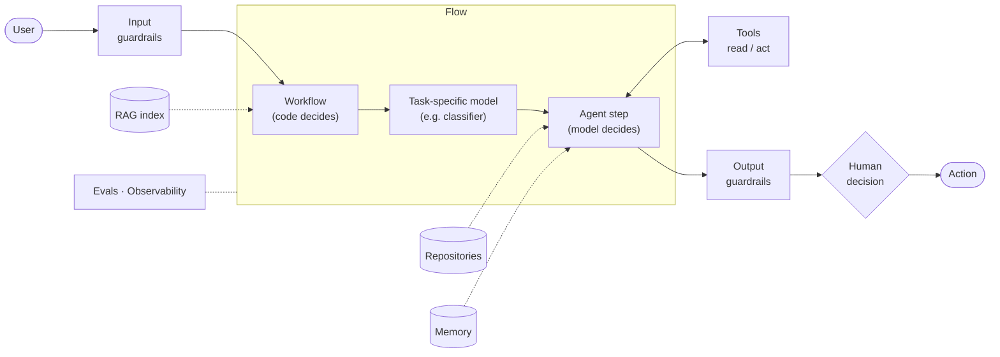

# One-pager

> **Disclaimer:** these are guidelines, not strict rules. They give a rationale and a structure for learning; adapt them to your problem and explain why.

The high-level solution a sponsor reads in two minutes. It summarises the project deck and adds nothing it does not support.

**Header:** `<system name>` · Owner · Version · Date

**Topics:** 1 Problem · 2 Solution · 3 Risks and guards · 4 Evals

---

## 1. Problem

> **[User]** struggles to **[task]** because **[cause]**, resulting in **[measurable consequence]**.

Baseline · Scope · Non-goals: same as the project deck.

## 2. Solution

**One hypothesis, one picture.** Keep only the components your design uses.

| Component | Used for | Catalog ID |
| --- | --- | --- |
| RAG index | | RAG-01 |
| Tool | | TL-01 |
| Model (GenAI / task-specific) | | MOD-01 |
| Workflow / agent | | WF-01, AG-01 |

| # | Use case | Target user | Priority |
| --- | --- | --- | --- |
| UC1 | | | ★ riskiest |

## 3. Risks and guards

| Risk | Guard |
| --- | --- |

Three at most. A guard is a mechanism (code check, approval, threshold), not an intention. Add the **key assumption** in one line.

## 4. Evals

| Measure | Metric | Baseline → target / threshold |
| --- | --- | --- |
| Value (success metric: time, cost, €) | | |
| Quality (eval) | | |
| Adoption | | |

End with **evidence so far** (proven vs. hypothesis) and the **decision asked**: what, from whom, by when.
